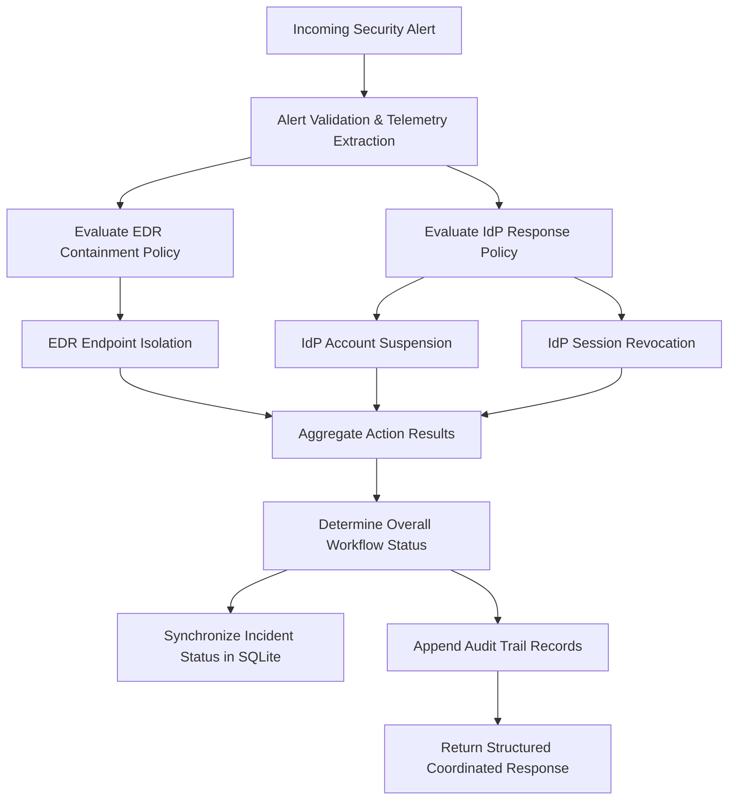

# Automated Ransomware Containment & Incident Response Orchestrator

An automated incident response orchestration platform designed to intake endpoint security alerts, validate and enrich threat indicators, store security incidents, and coordinate containment workflows against simulated ransomware attacks.

---

## Table of Contents
1. [Overview & Week 1 Architecture](#overview--week-1-architecture)
2. [EDR Integration Architecture & Clients](#edr-integration-architecture--clients)
3. [Simulated EDR Testing](#simulated-edr-testing)
4. [Webhook Security & Authentication](#webhook-security--authentication)
5. [Alert Parsing and Telemetry Enrichment (Day 5)](#alert-parsing-and-telemetry-enrichment-day-5)
6. [Incident Data Management & Storage (SQLite)](#incident-data-management--storage-sqlite)
7. [Network Containment Decision Logic (Week 2 Day 1)](#network-containment-decision-logic-week-2-day-1)
8. [Week 2 Day 2 — EDR Integration and Network Isolation](#week-2-day-2--edr-integration-and-network-isolation)
9. [Week 2 Day 3 — Containment Workflow Validation](#week-2-day-3--containment-workflow-validation)
10. [Week 2 Day 4 — Identity Provider Integration and Account Suspension](#week-2-day-4--identity-provider-integration-and-account-suspension)
11. [Week 2 Day 5 — Session Revocation and Coordinated Incident Response](#week-2-day-5--session-revocation-and-coordinated-incident-response)
12. [API Endpoints](#api-endpoints)
13. [Working with Incidents & Audit Trail](#working-with-incidents--audit-trail)
14. [Sending Test Alerts](#sending-test-alerts)
15. [Duplicate Alert Handling (Idempotency)](#duplicate-alert-handling-idempotency)
16. [Configuration & Environment Setup](#configuration--environment-setup)
17. [Running the Application](#running-the-application)
18. [Running the Test Suite](#running-the-test-suite)
19. [Current Limitations](#current-limitations)
20. [Security Best Practices](#security-best-practices)
21. [Week 3 — Forensic Acquisition, S3 Archival & Chain of Custody](#week-3--forensic-acquisition-s3-archival--chain-of-custody)

---

## Overview & Week 1 Architecture

The orchestrator serves as the central hub for receiving, parsing, enriching, storing, and triaging security alerts generated by Endpoint Detection and Response (EDR) platforms.

### Week 1 Progression
- **Day 1: Project Setup & Environment**: Repository baseline, Python virtual environment, package dependency pinning, and environment configuration management.
- **Day 2: FastAPI Backend**: Core FastAPI asynchronous web application, operational health-check endpoint (`GET /health`), and baseline alert intake route.
- **Day 3: EDR API Integration**: Modular client integration (`integrations/edr_client.py`) supporting CrowdStrike Falcon, Microsoft Defender for Endpoint, and safe `SimulatedEDRClient`.
- **Day 4: Secure EDR Webhook Intake**: Secure `POST /webhook/edr` endpoint enforcing constant-time shared secret verification (`X-Webhook-Secret`), request schema validation, and safe structured logging.
- **Day 5: Alert Parsing and Enrichment**: Dedicated parsing engine (`integrations/alert_parser.py`) implementing rigorous schema validation, severity normalization (1–5 scale), ISO 8601 UTC timestamp normalization, telemetry cleaning, and safe non-destructive ransomware heuristics.
- **Day 6: Integration Testing & Verification**: End-to-end integration testing (`tests/test_e2e_workflow.py`) validating the complete lifecycle from simulated webhook ingestion to storage, retrieval, status progression, and duplicate handling.

---

## EDR Integration Architecture & Clients

The integration layer (`integrations/edr_client.py`) interfaces with industry EDR solutions:
- **CrowdStrike Falcon (`CrowdStrikeClient`)**: Authenticates via OAuth 2.0 client credentials grant (`/oauth2/token`) and queries detections (`/detects/queries/detects/v1`).
- **Microsoft Defender for Endpoint (`DefenderClient`)**: Authenticates via Azure Active Directory OAuth 2.0 and queries tenant alerts (`/api/alerts`).
- **Simulated EDR Client (`SimulatedEDRClient`)**: Safe, mock client used during automated tests and development. Makes no outbound network requests.

Clients are instantiated cleanly using the factory function `create_edr_client(simulated=False)`.

---

## Simulated EDR Testing

To enable zero-risk development without requiring production credentials or live endpoints:
- `SimulatedEDRClient` produces realistic alert telemetry matching production schema formats.
- Alerts simulate high-severity ransomware activity (e.g., canary encryption detections, volume shadow copy deletion attempts).
- No actual system commands or file encryption routines are executed.

---

## Webhook Security & Authentication

Incoming webhook events delivered to `POST /webhook/edr` must present a shared secret:
1. **Header Verification**: Checked against `X-Webhook-Secret` or `Authorization: Bearer <secret>`.
2. **Timing-Attack Resistance**: Evaluated using Python's `secrets.compare_digest` constant-time comparison algorithm.
3. **Zero Credential Logging**: Headers, authentication tokens, and secrets are strictly excluded from logging statements.
4. **Environment Isolation**: The shared secret is configured exclusively via `WEBHOOK_SECRET` in `.env` (excluded from Git).

---

## Alert Parsing and Telemetry Enrichment (Day 5)

The `integrations/alert_parser.py` module ensures all incoming alerts conform to standard schema constraints before persistence:
- **Severity Normalization**: Textual ratings (`"critical"`, `"high"`, `"medium"`, `"low"`, `"informational"`) and numeric values are mapped to a uniform 1–5 scale.
- **Timestamp Standardization**: Converts arbitrary valid timestamps (including timezone offsets) into ISO 8601 UTC format (`YYYY-MM-DDTHH:MM:SSZ`).
- **Telemetry Sanitization**: Trims whitespace from hostnames, IP addresses, and usernames; converts cryptographic process hashes to uniform lowercase.
- **Ransomware Heuristic Flag**: Inspects alert categories and descriptions to tag `is_ransomware` indicators safely.
- **Safety**: Performs no external threat intelligence network lookups and executes no suspicious binaries.

---

## Incident Data Management & Storage (SQLite)

- **Default Storage Path**: `incidents.db` at the project root (configurable via `INCIDENTS_DB_PATH`).
- **Ignored by Git**: Excluded via `.gitignore` (`*.db`, `incidents.db`).
- **Database Schema**:
  - `alert_id` (TEXT, PRIMARY KEY): Unique identifier.
  - `threat_type` (TEXT, NOT NULL): Detection classification.
  - `severity` (INTEGER, NOT NULL): Normalized rating (1–5).
  - `description` (TEXT, NOT NULL): Alert description.
  - `hostname` (TEXT, NULLABLE): Target hostname.
  - `ip_address` (TEXT, NULLABLE): Network IP address.
  - `username` (TEXT, NULLABLE): Target user account.
  - `process_hash` (TEXT, NULLABLE): Normalized hash.
  - `timestamp` (TEXT, NOT NULL): Standardized ISO 8601 UTC timestamp.
  - `status` (TEXT, NOT NULL): Lifecycle state (`NEW`, `INVESTIGATING`, `CONTAINED`, `RESOLVED`).
  - `created_at` (TEXT, NOT NULL): UTC creation timestamp.
  - `updated_at` (TEXT, NOT NULL): UTC update timestamp.
- **Indexes**: Indexed on `status` and `severity`.

---

## Network Containment Decision Logic (Week 2 Day 1)

### What Network Containment Logic Does
The Network Containment Decision module (`containment/network_containment.py`) evaluates incoming security alerts to determine whether automated network isolation should be recommended for an affected endpoint. It acts as an automated triage gatekeeper: identifying the compromised machine, verifying alert integrity, evaluating policy conditions, and generating a structured decision record before any operational containment action is executed.

### How a Security Alert is Processed
1. **Intake & Object Handling**: Accepts Python dictionaries, structured objects, or Pydantic models (such as `Alert`, `ParsedAlert`).
2. **Schema & Field Validation (`validate_alert`)**:
   - Ensures payload is a non-empty mapping or object.
   - Validates that `alert_id` is present and non-empty.
   - Normalizes and checks severity using recognized numeric scales (1–5) and textual levels (`critical`, `high`, `medium`, `low`, `informational`).
   - Verifies affected endpoint identification: requires at least one of `hostname` or `endpoint_id`. If neither is provided, containment is rejected safely to prevent accidental or unidentifiable machine isolation.
   - Validates that `alert_type` (or `threat_type`) is present and non-empty.
   - Converts valid timestamps to standard ISO 8601 UTC format.
3. **Policy Evaluation (`evaluate_policy`)**:
   - Assesses the alert against the active `ContainmentPolicy` configuration.
4. **Structured Decision Generation (`build_containment_decision`)**:
   - Produces a consistent, structured dictionary with `alert_id`, `endpoint_id`, `hostname`, `containment_recommended`, `decision`, `reason`, and `timestamp`.
5. **Safe Logging**:
   - Logs receipt of alert, validation outcome, and decision generation without logging sensitive authentication credentials, tokens, or secrets.

### How Containment Conditions are Evaluated
The policy logic (`ContainmentPolicy`) uses configurable criteria rather than hardcoded thresholds:
- **Critical Ransomware**: Recommended for containment by default (`contain_critical_ransomware=True`).
- **Critical Hands-on-Keyboard**: Recommended for containment by default (`contain_critical_hands_on_keyboard=True`).
- **High-Severity Suspicious Activity**: Recommended for containment only when explicitly enabled in policy (`contain_high_suspicious_activity=True`; default is `False`).
- **Medium or Low Severity**: Does not trigger automatic containment under default policy (`contain_medium_low=False`).
- **Invalid or Incomplete Alerts**: Safely rejected (`CONTAINMENT_REJECTED`) without recommending containment.

### Day 1 vs. Day 2 Implementation Scope
- **Implemented on Day 1**:
  - Alert validation and machine identification logic.
  - Configurable containment policy rules and thresholds.
  - Structured decision generation (`CONTAINMENT_RECOMMENDED`, `CONTAINMENT_NOT_RECOMMENDED`, `CONTAINMENT_REJECTED`).
  - Dry-run safety mode enabled by default (`dry_run=True`).
  - Safe audit logging via Python's standard `logging` library.
  - Complete unit test suite (34 unit tests).
- **Scheduled for Day 2**:
  - Live EDR API containment integration (initiating network isolation requests via CrowdStrike Falcon / Microsoft Defender APIs).
  - Operating system network isolation command execution.
  - Automated post-containment incident status progression (`CONTAINED`).

### Example Input Alert

```json
{
  "alert_id": "ALERT-1001",
  "severity": "critical",
  "alert_type": "ransomware",
  "hostname": "LAB-WINDOWS-01",
  "endpoint_id": "ENDPOINT-001",
  "ip_address": "192.168.56.101",
  "username": "lab_user",
  "timestamp": "2026-10-16T10:30:00Z"
}
```

### Example Output Containment Decision

```json
{
  "alert_id": "ALERT-1001",
  "endpoint_id": "ENDPOINT-001",
  "hostname": "LAB-WINDOWS-01",
  "containment_recommended": true,
  "decision": "CONTAINMENT_RECOMMENDED",
  "reason": "Critical ransomware alert meets the configured containment policy.",
  "timestamp": "2026-10-16T10:30:00Z"
}
```

### How to Run the Module

Execute the module directly to run the built-in demonstration with sample alerts in dry-run mode:

```powershell
# Windows PowerShell
.\venv\Scripts\python -m containment.network_containment

# Or run directly
.\venv\Scripts\python containment\network_containment.py
```

### How to Execute Unit Tests

Run the dedicated containment unit test suite:

```powershell
# Run Day 1 Network Containment tests
.\venv\Scripts\pytest.exe tests/test_network_containment.py -v

# Run the full project test suite
.\venv\Scripts\pytest.exe -v
```

---

## Week 2 Day 2 — EDR Integration and Network Isolation

### Architecture & Overview
Week 2 Day 2 connects the Day 1 containment decision logic with actionable, automated network containment via Endpoint Detection and Response (EDR) APIs.

The containment orchestration pipeline operates in three integrated stages:
1. **Decision Gatekeeper (Day 1)**: Evaluates incoming alerts against `ContainmentPolicy` rules, validating alert schema and endpoint indicators before approving containment.
2. **Containment Orchestrator (Day 2)**: Coordinates the isolation workflow, enforces safety execution modes (Dry-Run vs. Authorized Live), checks duplicate suppression cooldowns, dispatches API requests to the EDR platform, and transitions incident lifecycle states.
3. **EDR Client Integration Layer**: Interacts with production EDR platforms or simulated test adapters:
   - **CrowdStrike Falcon (`CrowdStrikeClient`)**: Calls `POST /devices/entities/devices-actions/v2?action_name=contain` using OAuth 2.0 client credentials.
   - **Microsoft Defender for Endpoint (`DefenderClient`)**: Calls `POST /api/machines/{id}/isolate` with `IsolationType: "Full"` using Azure AD OAuth 2.0.
   - **Simulated EDR Client (`SimulatedEDRClient`)**: Provides realistic mock isolation responses without making external network calls.

### Relationship Between Day 1 and Day 2
- **Day 1**: Pure decision evaluation. Given an alert, it verifies structure, assesses severity and alert types, and generates a `ContainmentDecision` (`CONTAINMENT_RECOMMENDED`, `CONTAINMENT_NOT_RECOMMENDED`, or `CONTAINMENT_REJECTED`). It does not invoke network APIs or OS commands.
- **Day 2**: Operational execution. Reuses Day 1 logic as a mandatory prerequisite gate. If Day 1 recommends containment and the alert includes a valid `endpoint_id`, Day 2 prepares an authorized EDR isolation request, submits it through the configured client, parses the response, and records the result. If Day 1 rejects or does not recommend containment, Day 2 halts immediately without contacting the EDR API.

### Selected EDR Providers & Mock Implementation
- **Supported Live Providers**: CrowdStrike Falcon and Microsoft Defender for Endpoint.
- **Testing & Development**: The project provides concrete REST API client classes for both CrowdStrike Falcon and Microsoft Defender for Endpoint, paired with a safe, built-in mock adapter (`SimulatedEDRClient`). In automated test suites and local development, the mock adapter and `unittest.mock` are used exclusively. No real endpoints are ever isolated during tests.
- **Implementation State**: Both providers are implemented cleanly without external SDK bloat, using Python's standard `requests` library.

### Preserving Administrative Management Access
Both supported EDR providers natively maintain management connectivity during network isolation:
- **CrowdStrike Falcon**: Device containment cuts general IP communication while keeping the Falcon sensor's TLS management channel open to the Falcon cloud console.
- **Microsoft Defender for Endpoint**: Machine isolation (`IsolationType: "Full"`) severs network connections while preserving connectivity to Defender cloud services and Intune.
- *Notice*: Verification of actual host isolation and management connectivity retention must be conducted in an authorized sandbox or lab network before deployment in production.

### Safe Execution Modes

#### Mode A: Dry-Run (Default)
- **Status**: Enabled by default (`dry_run=True`).
- **Behavior**: Evaluates Day 1 policy, identifies target machine, and returns a simulated result (`status: "SIMULATED"`).
- **Network Actions**: Zero outbound EDR network calls are dispatched.
- **Guarantee**: Never claims that a real machine was isolated (`isolation_requested: false`).

#### Mode B: Authorized EDR Execution
- **Status**: Disabled by default.
- **Activation**: Requires setting `EDR_EXECUTION_MODE=live` and `EDR_DRY_RUN=false` in `.env`, or passing `dry_run=False` in code.
- **Prerequisites**: Valid EDR credentials, positive Day 1 recommendation, non-empty `endpoint_id`, and clearance from the duplicate request suppression registry.
- **Result Handling**: Dispatches live isolation API call and maps response to `CONFIRMED`, `REQUESTED`, `FAILED`, or `UNKNOWN`. Never falls back silently to simulated success on failure.

### Required Environment Variables

Configure these settings in `.env` (template available in `.env.example`):

| Variable | Description | Example / Allowed Values | Default |
|---|---|---|---|
| `EDR_PROVIDER` | Active EDR platform | `crowdstrike` or `defender` | (Required in live mode) |
| `EDR_API_BASE_URL` | Base URL of EDR REST API | `https://api.crowdstrike.com` | (Required in live mode) |
| `EDR_CLIENT_ID` | OAuth 2.0 client/application ID | `your-client-id` | (Required in live mode) |
| `EDR_CLIENT_SECRET` | OAuth 2.0 client secret | `your-client-secret` | (Required in live mode) |
| `EDR_TENANT_ID` | Azure AD tenant ID (Defender only) | `your-tenant-uuid` | None |
| `EDR_TIMEOUT_SECONDS` | HTTP request timeout in seconds | `10` | `10` |
| `EDR_EXECUTION_MODE` | Operational safety mode | `dry_run` or `live` | `dry_run` |
| `EDR_DRY_RUN` | Secondary dry-run boolean toggle | `true` or `false` | `true` |

> [!CAUTION]
> Never commit real EDR client secrets, tokens, or tenant IDs to version control. Keep credentials in `.env`, which is strictly excluded by `.gitignore`.

### Response Status Lifecycle

The orchestrator returns structured results matching the following states:

| Status | Meaning | Isolation Requested |
|---|---|---|
| `SIMULATED` | Dry-run mode completed safely. No outbound EDR request was sent. | `false` |
| `CONFIRMED` | EDR provider confirmed that network isolation succeeded on the endpoint. | `true` |
| `REQUESTED` | EDR provider accepted the isolation request; action is queued or in-progress. | `true` |
| `FAILED` | Isolation request failed (auth failure, permission denied, timeout, or API error). | `true` / `false` |
| `UNKNOWN` | Provider returned an ambiguous, unrecognized, or partial response payload. | `true` |
| `NOT_RECOMMENDED` | Alert policy evaluation did not recommend containment (e.g. low severity). | `false` |
| `REJECTED` | Alert payload validation failed or missing required `endpoint_id`. | `false` |

### Failure Handling & Safeguards
1. **No False Success**: If an EDR API call times out or returns HTTP 4xx/5xx, status is marked `FAILED` with diagnostic reason. It never falls back to `SIMULATED` or `CONFIRMED`.
2. **Duplicate Suppression**: The `ContainmentRegistry` caches recently isolated endpoints within a configurable cooldown window (default: 300 seconds). Redundant requests return `CONFIRMED` with `isolation_requested=false`, preventing API spamming or race conditions.
3. **Zero Secrets in Logs**: All HTTP headers, Bearer tokens, and secrets are strictly excluded from logging.
4. **Idempotent Incident Progression**: When an isolation is `CONFIRMED`, any corresponding SQLite incident record is automatically transitioned to `CONTAINED`.

### Limitations of Mock Implementation & Sandbox Requirements
- **Mock Adapter Limitations**: `SimulatedEDRClient` generates representative payloads simulating CrowdStrike and Defender responses. It does not emulate real sensor heartbeats, kernel agent communication delays, or live network packet dropping.
- **Sandbox Testing Requirements**:
  1. A dedicated, non-production test tenant in CrowdStrike Falcon or Microsoft Defender for Endpoint.
  2. Dedicated virtual machines (canary endpoints) with network isolation permissions.
  3. Pre-configured API client credentials scoped strictly to device action containment (`devices:write` in CrowdStrike, `Machine.Isolate` in Microsoft Graph/Defender).
  4. Out-of-band management connectivity (such as hypervisor console or cloud VM serial console) to access endpoints if isolation prevents standard administrative SSH/RDP.

### Running the Integration in Dry-Run Mode

```powershell
# Run the built-in CLI demonstration in dry-run mode
.\venv\Scripts\python containment\network_containment.py
```

### Running the Automated Tests

```powershell
# Run all Week 2 Day 2 EDR Containment tests (36 tests)
.\venv\Scripts\pytest.exe tests/test_network_containment_edr.py -v

# Run the complete project test suite (166 tests)
.\venv\Scripts\pytest.exe -v
```

---

## Week 2 Day 3 — Containment Workflow Validation

### Overview
Week 2 Day 3 integrates and end-to-end validates the entire automated network containment pipeline—connecting alert intake through schema normalization, policy decision evaluation, duplicate suppression, EDR client execution, and transactional SQLite incident state transitions.

### The Complete Alert-to-Containment Workflow
The orchestrated pipeline follows a strict, safe, 13-stage progression:
1. **Alert Ingestion**: Security alert telemetry is received via the secure webhook (`POST /webhook/edr`) or direct orchestration API (`POST /containment/isolate` / `process_containment_workflow`).
2. **Authentication Verification**: Request authenticity is validated using constant-time comparison against `WEBHOOK_SECRET` without leaking secrets in logs or responses.
3. **Parsing & Normalization**: `integrations/alert_parser.py` validates required fields, standardizes timestamps to ISO 8601 UTC, sanitizes telemetry strings, extracts `endpoint_id`, and maps severities into a uniform 1–5 scale.
4. **Endpoint Identification**: The compromised machine's `hostname` and `endpoint_id` are identified and verified.
5. **Initial Incident Recording**: The alert is recorded in the SQLite incident store with initial status `NEW` (idempotently recognizing duplicates).
6. **Day 1 Containment Policy Evaluation**: `evaluate_containment()` evaluates active policy rules against the normalized telemetry (e.g., critical ransomware, hands-on-keyboard activity).
7. **Policy Gatekeeper**: Alerts that do not qualify (medium/low severity) or are malformed receive `NOT_RECOMMENDED` or `REJECTED`. The EDR API is never contacted for unqualified alerts.
8. **Endpoint Identifier Verification**: If containment is recommended, `endpoint_id` must be present. If missing, isolation is safely rejected (`REJECTED`) without contacting EDR.
9. **Duplicate Request Protection**: `ContainmentRegistry` checks if the endpoint has an active isolation record within the cooldown window (default: 300 seconds). If already contained, duplicate requests are suppressed without calling EDR.
10. **Execution Mode Enforcement**: Dry-run mode (`dry_run=True`) is enabled by default. In dry-run mode, the workflow returns `SIMULATED` with zero outbound EDR calls. Live mode (`dry_run=False`) dispatches the isolation request to the configured EDR client.
11. **EDR Response Processing**: `parse_edr_isolation_response()` maps provider-specific payloads to standard statuses (`CONFIRMED`, `REQUESTED`, `FAILED`, `UNKNOWN`). Never reports false success on failure.
12. **Incident Store Synchronization**:
    - `CONFIRMED`: Incident transitions to `CONTAINED`.
    - `REQUESTED`: Incident transitions from `NEW` to `INVESTIGATING` (retains pending state).
    - `FAILED` / `UNKNOWN` / `SIMULATED` / `NOT_RECOMMENDED` / `REJECTED`: Incident is never marked `CONTAINED`.
13. **Structured Response & Safe Audit Logging**: Returns a structured outcome dictionary with incident state, and writes audit logs without sensitive tokens or credentials.

### Relationship Between Day 1, Day 2, and Day 3
- **Day 1 (Policy Logic)**: Defined policy rules (`ContainmentPolicy`) and pure decision logic (`evaluate_containment`), outputting recommendations (`CONTAINMENT_RECOMMENDED`, `CONTAINMENT_NOT_RECOMMENDED`, `CONTAINMENT_REJECTED`) without external side-effects or network calls.
- **Day 2 (EDR Integration)**: Implemented EDR API clients (`CrowdStrikeClient`, `DefenderClient`, `SimulatedEDRClient`) and `execute_network_containment`, supporting execution modes and provider response parsing.
- **Day 3 (Workflow Integration & Validation)**: Bridges ingestion and containment together into an end-to-end orchestrated workflow (`process_containment_workflow` and `/webhook/edr`), binds containment results to the SQLite incident lifecycle, validates duplicate protection cooldowns and failure handling, and provides an end-to-end automated test suite covering all 20 required scenarios.

### How Dry-Run Mode Works
- **Default Behavior**: Enabled by default (`dry_run=True` in code, `EDR_EXECUTION_MODE=dry_run` or `EDR_DRY_RUN=true` in environment).
- **Safety Guarantee**: Evaluates telemetry and policy, but bypasses all outbound EDR network calls. Returns `status="SIMULATED"`, `isolation_requested=false`.
- **Database Safety**: Incidents remain in `NEW` status and are never marked `CONTAINED` during dry-run simulation.

### Incident Lifecycle Transitions
| Containment Outcome | Previous Incident Status | New Incident Status | Description |
|---|---|---|---|
| `CONFIRMED` | `NEW` / `INVESTIGATING` | `CONTAINED` | Successful live isolation confirmed by EDR platform |
| `REQUESTED` | `NEW` | `INVESTIGATING` | Isolation request accepted by EDR; queued or in-progress |
| `FAILED` | `NEW` | `NEW` (Unchanged) | EDR error/timeout; never falsely marked CONTAINED |
| `UNKNOWN` | `NEW` | `NEW` (Unchanged) | Ambiguous EDR response; preserves uncertainty |
| `SIMULATED` | `NEW` | `NEW` (Unchanged) | Dry-run mode completed; no real isolation |
| `NOT_RECOMMENDED`| `NEW` | `NEW` (Unchanged) | Policy rejected containment (e.g. low severity) |
| `REJECTED` | `NEW` | `NEW` (Unchanged) | Missing `endpoint_id` or malformed alert |

### Duplicate Request Protection (ContainmentRegistry)
- **Cooldown Window**: Tracks isolated endpoints within a configurable cooldown window (default: 300 seconds).
- **Suppression Behavior**: Subsequent alerts for an endpoint already `CONFIRMED` or `REQUESTED` return the prior status with `isolation_requested=false`, preventing EDR API spamming.
- **Independent Endpoint Tracking**: Separate endpoints receive independent tracking and do not block one another.
- **Failure Retry Guarantee**: Failed isolation attempts (`STATUS_FAILED`) are deliberately NOT stored in the registry, permitting immediate retries.
- **In-Memory Limitation**: The registry is an in-memory, process-local store protected by `threading.Lock`. It prevents duplicate requests within a single runtime process, but does not persist across restarts or across multi-process workers without an external distributed store like Redis.

### Failure Handling & Safeguards
- **Authentication Failures (`EDRAuthError`)**: Caught safely, logged without leaking secrets or tokens, status marked `FAILED`.
- **API Timeouts (`EDRTimeoutError`)**: Caught safely after the configured timeout (default: 10s), status marked `FAILED`.
- **Server Errors (`EDRAPIError`)**: HTTP 5xx responses mapped to `FAILED` without crashing the service.
- **Malformed Responses**: Responses lacking expected resource arrays or status fields map to `UNKNOWN`.
- **No False Success**: The orchestrator never converts an API failure or timeout into a simulated or confirmed success.

### Running the Application Locally
```powershell
# Activate virtual environment
.\venv\Scripts\Activate.ps1

# Run the FastAPI server via Uvicorn
uvicorn main:app --host 127.0.0.1 --port 8000 --reload
```

### Running the Automated Test Suite
```powershell
# Run the complete test suite (166 tests passing)
.\venv\Scripts\pytest -v

# Run the end-to-end workflow validation suite specifically (18 tests)
.\venv\Scripts\pytest -v tests/test_e2e_workflow.py

# Run Day 1 and Day 2 containment tests
.\venv\Scripts\pytest -v tests/test_network_containment.py tests/test_network_containment_edr.py
```

### Current Limitations & Testing Disclosures
- **Mock-Based Testing**: All 166 automated unit and integration tests execute exclusively using mocked EDR clients (`SimulatedEDRClient` or `unittest.mock.MagicMock`) and an isolated temporary SQLite database.
- **Zero Real Endpoint Isolation**: Automated tests do NOT isolate real production or development endpoints. No outbound EDR API calls are made during tests.
- **Live EDR Tenant Verification Notice**: Live integration against production CrowdStrike Falcon or Microsoft Defender for Endpoint tenants has NOT been verified on live infrastructure. Verification requires an authorized non-production sandbox environment with canary virtual machines, out-of-band serial/hypervisor console access, and properly scoped OAuth 2.0 API credentials.

---

## Week 2 Day 4 — Identity Provider Integration and Account Suspension

### Overview
Week 2 Day 4 integrates an enterprise Identity Provider (IdP) into the incident response pipeline. When a security alert indicates a high-severity threat (such as ransomware execution or interactive hands-on-keyboard adversary intrusion), the orchestrator can resolve the associated human or service account and execute policy-governed account suspension.

### Architecture & Supported Identity Providers
The identity provider integration module (`integrations/identity_client.py`) provides a clean, decoupled abstraction:
- **Microsoft Entra ID / Microsoft Graph API (`EntraIDClient`)**:
  - Authenticates via OAuth 2.0 Client Credentials Grant against Azure AD token endpoint:
    `POST https://login.microsoftonline.com/{tenant_id}/oauth2/v2.0/token`
    with scope `https://graph.microsoft.com/.default`.
  - Performs directory user lookups and account updates via Microsoft Graph API v1.0.
  - Disables user sign-in by submitting a PATCH request:
    `PATCH https://graph.microsoft.com/v1.0/users/{user_id}` with payload `{"accountEnabled": false}`.
    (Microsoft Graph returns `HTTP 204 No Content` upon successful modification).
- **Simulated Identity Client (`SimulatedIdentityClient` / `MockIdentityClient`)**:
  - Safe, local in-memory directory adapter for testing and development without live tenant credentials.
  - Accurately models directory identities, status transitions, and failure injection modes (timeouts, authentication errors, authorization errors, malformed responses, and ambiguous identities).
  - Makes zero outbound network calls and modifies no external user accounts.

### User Resolution Hierarchy & Safety Rules
The orchestrator safely resolves user accounts from incoming alert telemetry (`extract_user_identifier`):
1. **Directory User ID (`directory_user_id` / `user_id`)**: Highest precedence; queries stable directory UUID (`/v1.0/users/{id}`).
2. **User Principal Name (`user_principal_name` / `upn`)**: Direct directory lookup (`/v1.0/users/{upn}`).
3. **Email Address (`email` / `mail`)**: Evaluates directory filter `mail eq '{email}' or userPrincipalName eq '{email}'`.
4. **Username (`username`)**: Fallback search across directory attributes.
5. **Ambiguous Identity Rejection**: If a search matches multiple directory accounts, the orchestrator raises `AmbiguousUserError` and rejects the action (`STATUS_REJECTED`) to avoid modifying unintended accounts.
6. **Strict IP-Only Safety Rule**: Account suspension is **NEVER** executed based solely on an IP address or hostname. If no user telemetry is present in the alert, the action is rejected safely.

### Account Protection Safeguards
To prevent catastrophic automated lockouts, hard-coded and configurable safeguards are enforced before any account suspension:
- **Emergency Administrator Accounts**: Protects break-glass accounts (e.g., `breakglass`, `emergency-admin`, `admin`, `root`).
- **Orchestrator Service Account**: Shields the orchestrator's own service identity (e.g., `svc-orchestrator`, `orchestrator`) from suspending itself.
- **Configurable Protected Accounts**: Environment variable `IDENTITY_PROTECTED_ACCOUNTS` defines additional protected accounts.
- **Optional Test-Account Allowlist**: In authorized live test environments, `IDENTITY_TEST_ACCOUNT_ALLOWLIST` can restrict automated operations to permitted test accounts only.

### Structured Account-Suspension Result Schema
Adheres to the required Day 4 result specification:
```json
{
  "alert_id": "ALERT-1001",
  "user_id": "c0a80101-0002-0000-0000-000000000002",
  "user_principal_name": "compromised.user@contoso.com",
  "identity_provider": "entra_id",
  "action": "SUSPEND_ACCOUNT",
  "execution_mode": "dry_run",
  "status": "SIMULATED",
  "message": "Account suspension simulated; no account modified."
}
```

---

## Week 2 Day 5 — Session Revocation and Coordinated Incident Response

### Overview
Week 2 Day 5 extends the identity integration to support user session revocation and orchestrates all response actions—EDR network containment, IdP account suspension, and IdP session revocation—into a unified, coordinated incident response workflow with transactional SQLite state transitions and an immutable audit trail.

### Session Revocation Architecture & Limitations
- **Microsoft Graph API Operation**:
  - `POST https://graph.microsoft.com/v1.0/users/{user_id}/revokeSignInSessions` with empty JSON body `{}`.
  - Graph API returns `HTTP 200 OK` with payload `{"value": true}`.
- **Required Microsoft Graph Permissions**:
  - `User.RevokeSessions.All` or `Directory.ReadWrite.All`.
- **Token Invalidation Scope & Limitations**:
  - **Refresh Tokens & Browser Cookies**: Immediately invalidated across all devices upon successful session revocation.
  - **Existing Access Tokens**: Standard OAuth 2.0 access tokens remain valid until their expiration window (typically 60 minutes) unless **Continuous Access Evaluation (CAE)** is enabled in the Microsoft Entra tenant.
  - Session revocation is maintained as a separate, distinct action from account suspension.
- **Unsupported Providers**: If an identity provider does not support session revocation, the orchestrator returns `STATUS_UNSUPPORTED` rather than falsely claiming success.

### Coordinated Incident Response Workflow
The multi-action orchestrator (`process_coordinated_response_workflow` / `POST /containment/coordinate`) coordinates remediation across endpoints and identities:



### Robust Partial-Success Handling
The orchestrator explicitly tracks and returns individual outcomes for each action:
- **Endpoint Isolation Succeeds, Identity Fails**: The endpoint is isolated and the incident transitions to `CONTAINED`. Identity failure is recorded; overall status is `PARTIAL_SUCCESS`.
- **Identity Suspension Succeeds, EDR Isolation Fails**: Account is suspended, but the incident is **NOT** marked `CONTAINED` (it transitions to `INVESTIGATING`). Overall status is `PARTIAL_SUCCESS`.
- **One Action Returns UNKNOWN or Times Out**: Uncertainty is preserved; the system never converts an API timeout or error into false success.
- **No Automatic Reversal**: The system does not undo a successful endpoint containment if a subsequent identity call fails.

### Structured Coordinated Response Schema
Adheres to the required Day 5 result specification:
```json
{
  "alert_id": "ALERT-1001",
  "incident_id": "ALERT-1001",
  "endpoint_containment": {
    "status": "SIMULATED",
    "action": "ISOLATE_ENDPOINT",
    "endpoint_id": "EP-001",
    "provider": "simulated",
    "action_id": "sim-action-EP-001",
    "message": "Dry run completed. No EDR request was sent."
  },
  "account_suspension": {
    "status": "SIMULATED",
    "action": "SUSPEND_ACCOUNT",
    "user_id": "c0a80101-0002-0000-0000-000000000002",
    "user_principal_name": "compromised.user@contoso.com",
    "provider": "simulated",
    "action_id": "sim-susp-c0a80101-0002-0000-0000-000000000002",
    "message": "Account suspension simulated; no account modified."
  },
  "session_revocation": {
    "status": "SIMULATED",
    "action": "REVOKE_SESSIONS",
    "user_id": "c0a80101-0002-0000-0000-000000000002",
    "user_principal_name": "compromised.user@contoso.com",
    "provider": "simulated",
    "action_id": "sim-revoke-c0a80101-0002-0000-0000-000000000002",
    "message": "User session revocation simulated; no real sessions revoked."
  },
  "overall_status": "SIMULATED",
  "message": "Response workflow simulated; no real actions executed.",
  "incident_status": "NEW"
}
```

### Idempotency & Duplicate Suppression (IdentityActionRegistry)
- **Cooldown Window**: Tracks user account actions in `IdentityActionRegistry` with a default 300-second cooldown.
- **Duplicate Suppression**: Repeated requests for the same user within the window return prior status without contacting the IdP.
- **Thread Safety**: Protected with process-local `threading.Lock`.

### Audit Logging & Zero-Secret Guarantee
- **Database Table (`incident_audit_logs`)**: Records `alert_id`, `incident_id`, `identity_provider`, `user_id`, `action`, `execution_mode`, `status`, `message`, `correlation_id`, `details`, and `timestamp`.
- **Sanitization Engine (`sanitize_audit_data`)**: Automatically detects and redacts client secrets, passwords, bearer tokens, and authorization headers from logs and database records.

---

## Week 2 Day 6 — Sandbox Testing and Final Validation

### Sandbox Architecture
Week 2 Day 6 provides end-to-end sandbox validation of the complete incident response pipeline under safe, simulated, and read-only conditions:

```
┌────────────────────────────────────────────────────────────────────────┐
│                   Sandbox Validation Pipeline                         │
├─────────────────┬───────────────────┬──────────────────────────────────┤
│ 1. Alert Intake │ 2. Decision Logic │ 3. Simulated Remediation        │
│    • /webhook/edr│    • Containment   │    • EDR Host Isolation (dry)    │
│    • Auth & Parse│      Policy Eval   │    • Account Suspension (dry)    │
│    • Idempotency │    • Identity      │    • Session Revocation (dry)    │
│      Suppression │      Safeguards    │    • Zero Destructive Actions    │
├─────────────────┴───────────────────┴──────────────────────────────────┤
│ 4. Coordination, Audit Trail & State Synchronization                  │
│    • Partial-Success Resolution (PARTIAL_SUCCESS / CONFIRMED / FAILED) │
│    • SQLite Incident Lifecycle Progression (NEW -> CONTAINED)          │
│    • Immutable Audit Logging with Automatic Secret Scrubbing           │
└────────────────────────────────────────────────────────────────────────┘
```

### Setup and Startup Commands
Activate the Python virtual environment and start the Uvicorn application server:

```powershell
# Windows PowerShell
.\venv\Scripts\Activate.ps1
.\venv\Scripts\python.exe -m uvicorn main:app --reload --host 127.0.0.1 --port 8000
```

- **Interactive API Documentation (Swagger UI)**: `http://127.0.0.1:8000/docs`
- **Alternative ReDoc Interface**: `http://127.0.0.1:8000/redoc`
- **Application Health Check**: `http://127.0.0.1:8000/health`

### Environment Configuration Requirements
Sandbox testing relies on safe defaults configured in `.env` (derived from `.env.example`):
- `EDR_EXECUTION_MODE=dry_run` & `EDR_DRY_RUN=true`: Prevents real host isolation requests.
- `IDENTITY_EXECUTION_MODE=dry_run` & `IDENTITY_DRY_RUN=true`: Prevents real account modifications or session invalidations.
- `IDENTITY_PROVIDER=mock`: Directs identity calls to the in-memory simulated provider.
- `WEBHOOK_SECRET`: Secure shared secret verified with constant-time comparison (`secrets.compare_digest`).
- `IDENTITY_PROTECTED_ACCOUNTS`: Prevents accidental actions against administrator and service accounts.

### API Testing Instructions
Test endpoints interactively using Swagger UI (`http://127.0.0.1:8000/docs`) or programmatically via PowerShell:

```powershell
# Health Check
Invoke-RestMethod -Uri "http://127.0.0.1:8000/health" -Method Get

# Webhook Alert Ingestion (with constant-time auth header)
$headers = @{ "X-Webhook-Secret" = "your-secure-webhook-secret-here"; "Content-Type" = "application/json" }
$body = @{
    alert_id    = "SYN-CRIT-001"
    threat_type = "ransomware"
    severity    = 5
    description = "Critical simulated ransomware alert"
    timestamp   = "2026-10-22T10:00:00Z"
    hostname    = "FIN-WORKSTATION-01"
    endpoint_id = "EP-SYN-001"
    username    = "victim.user@contoso.com"
} | ConvertTo-Json
Invoke-RestMethod -Uri "http://127.0.0.1:8000/webhook/edr" -Method Post -Headers $headers -Body $body

# Retrieve Audit Trail
Invoke-RestMethod -Uri "http://127.0.0.1:8000/incidents/SYN-CRIT-001/audit-logs" -Method Get
```

### Synthetic Ransomware Alert Scenarios
The validation suite exercises 6 distinct synthetic alert scenarios:
1. **Scenario A (Critical Ransomware Alert)**: High severity triggers recommendation and simulated EDR isolation.
2. **Scenario B (Low-Severity Alert)**: Informational/low severity returns non-containment decision (`STATUS_NOT_RECOMMENDED`).
3. **Scenario C (Malformed Alert)**: Missing required fields rejected safely with `HTTP 422 Unprocessable Entity`.
4. **Scenario D (Missing Endpoint ID)**: Alert lacking hostname and machine identifier rejected safely without dispatching isolation.
5. **Scenario E (Duplicate Alert)**: Duplicate webhook deliveries detected and idempotently acknowledged with `"status": "duplicate"`.
6. **Scenario F (Missing or Ambiguous User)**: Safely rejects account actions when user telemetry is missing or resolves to multiple directory accounts.

### Dry-Run Safety Behavior
- **Default Inactive Execution**: All containment, suspension, and revocation modules default to `dry_run=True`.
- **Zero Real Modifications**: Automated test fixtures and sandbox runs execute zero destructive operations against external platforms.
- **Redaction by Design**: `sanitize_audit_data()` strips bearer tokens, passwords, and client secrets from logs and database records.

### CrowdStrike Authentication & Read-Only API Results
Read-only validation against the live CrowdStrike Falcon tenant confirmed:
- **OAuth 2.0 Authentication**: Successfully acquired Bearer token from `/oauth2/token`.
- **Modern Alerts API**: Successfully queried `/alerts/queries/alerts/v1` with zero errors.
- **Device Records Query**: Successfully queried `/devices/queries/devices/v1`.
- **Registered Sensor Endpoints**: Returned 0 endpoints. This is a valid tenant state representing a test tenant without active physical or virtual sensor agents installed.
- **Simulated vs Live Isolation**: Successfully authenticating and querying read-only APIs does **not** grant or imply live endpoint isolation capability. Destructive containment remains strictly simulated.

---

## API Endpoints

| Method | Endpoint | Description | Auth Required | Required Permission |
|---|---|---|---|---|
| `GET` | `/health` | Health-check endpoint verifying operational status | No | Public |
| `POST` | `/alert` | Baseline alert intake (backwards compatible) | No | Public |
| `POST` | `/webhook/edr` | Secure webhook endpoint for incoming EDR alerts | **Yes (`X-Webhook-Secret`)** | Webhook Shared Secret |
| `POST` | `/containment/isolate` | Network Containment & EDR Host Isolation | **Yes (`X-API-Key` / Bearer)** | `containment:execute` |
| `POST` | `/identity/suspend` | IdP User Account Suspension | **Yes (`X-API-Key` / Bearer)** | `identity:suspend` |
| `POST` | `/identity/revoke-sessions` | IdP User Sign-in Session Revocation | **Yes (`X-API-Key` / Bearer)** | `identity:revoke` |
| `POST` | `/containment/coordinate` | Coordinated Incident Response (EDR + IdP) | **Yes (`X-API-Key` / Bearer)** | `containment:coordinate` |
| `GET` | `/incidents/{alert_id}/audit-logs`| Retrieve Chronological Audit Trail for an Alert | No | Public |
| `POST` | `/incidents` | Manually record an incident (`409 Conflict` on duplicate ID) | No | Public |
| `GET` | `/incidents` | List all incidents (with optional `status` & `severity` filters) | No | Public |
| `GET` | `/incidents/{alert_id}` | Retrieve single incident details (`404 Not Found` if missing) | No | Public |
| `PATCH` | `/incidents/{alert_id}/status` | Update incident lifecycle status | **Yes (`X-API-Key` / Bearer)** | `incident:write` |
| `GET` | `/docs` | Interactive Swagger API documentation | No | Public |

---

## Working with Incidents

### 1. Create an Incident (`POST /incidents`)

```bash
curl -X POST "http://127.0.0.1:8000/incidents" \
  -H "Content-Type: application/json" \
  -d '{
    "alert_id": "inc-2026-001",
    "threat_type": "ransomware",
    "severity": 5,
    "description": "Mass file encryption in C:\\Users\\Public detected",
    "hostname": "HOST-PROD-01",
    "ip_address": "10.0.4.15",
    "username": "admin_ops",
    "process_hash": "e3b0c44298fc1c149afbf4c8996fb92427ae41e4649b934ca495991b7852b855",
    "timestamp": "2026-10-12T14:00:00Z",
    "status": "NEW"
  }'
```

### 2. List Incidents with Filtering (`GET /incidents`)

```bash
curl -X GET "http://127.0.0.1:8000/incidents?status=NEW&severity=5"
```

### 3. Update Incident Status (`PATCH /incidents/{alert_id}/status`)

```bash
curl -X PATCH "http://127.0.0.1:8000/incidents/inc-2026-001/status" \
  -H "Content-Type: application/json" \
  -d '{
    "status": "INVESTIGATING"
  }'
```

---

## Sending Test Alerts

### Using PowerShell (`Invoke-RestMethod`)

```powershell
$headers = @{
    "Content-Type"     = "application/json"
    "X-Webhook-Secret" = "your-secure-webhook-secret-here"
}

$body = @{
    alert_id     = "alert-edr-004"
    threat_type  = "ransomware"
    severity     = 4
    description  = "Simulated ransomware activity detected"
    timestamp    = "2026-10-12T10:00:00Z"
    hostname     = "LAB-PC-01"
    ip_address   = "192.168.1.100"
    username     = "lab_user"
    process_hash = "example_hash"
} | ConvertTo-Json

Invoke-RestMethod -Uri "http://127.0.0.1:8000/webhook/edr" -Method Post -Headers $headers -Body $body
```

---

## Duplicate Alert Handling (Idempotency)

- **Webhook Ingestion (`POST /webhook/edr`)**: Handled idempotently. Repeated webhook deliveries for the same `alert_id` (e.g. delivery retries) are recognized safely, return `HTTP 200` with `"status": "duplicate"`, and do not create duplicate database records.
- **Manual API Ingestion (`POST /incidents`)**: Rejects duplicate `alert_id` submissions with `HTTP 409 Conflict`.

---

## Configuration & Environment Setup

Copy `.env.example` to `.env` and configure required values:

```bash
# Windows PowerShell
Copy-Item .env.example .env

# Linux / macOS
cp .env.example .env
```

Key environment parameters:
- `ORCHESTRATOR_API_KEY`: Primary API key for securing sensitive endpoints.
- `WEBHOOK_SECRET`: Secret token for webhook verification.
- `INCIDENTS_DB_PATH`: SQLite database file path (default: `incidents.db`).
- `EDR_PROVIDER`: `crowdstrike` or `defender` (when using production EDR).
- `EDR_EXECUTION_MODE`: `dry_run` (default) or `live`.

---

## Running the Application

Activate your virtual environment and start the Uvicorn server:

```powershell
# Windows PowerShell
.\venv\Scripts\Activate.ps1
uvicorn main:app --reload --host 127.0.0.1 --port 8000
```

- Server: `http://127.0.0.1:8000`
- Swagger UI: `http://127.0.0.1:8000/docs`
- ReDoc UI: `http://127.0.0.1:8000/redoc`

---

## Running the Test Suite

The repository contains two test suites: the primary root test suite (validating the end-to-end orchestrator, API security, adapters, validators, and coordination) and the nested subproject test suite.

Pytest discovery is cleanly decoupled via dedicated `pytest.ini` files with explicit `testpaths = tests` and `pythonpath = .` to prevent namespace collisions.

### 1. Running the Primary Root Test Suite (350 Tests)

```powershell
# Windows PowerShell
.\venv\Scripts\python.exe -m pytest tests/ -v
```

### 2. Running the Nested Subproject Test Suite (21 Tests)

```powershell
# Windows PowerShell
.\venv\Scripts\python.exe -m pytest ransomware-response-orchestrator/tests/ -v
```

### Complete Test Coverage Breakdown (350 Root Tests Passing):
- **API Security & RBAC Authorization Tests (`tests/test_api_security.py`) — 19 Tests**:
  - Rejection of unauthenticated requests across all 5 sensitive endpoints (`401 Unauthorized`).
  - Rejection of invalid API keys, malformed JWTs, expired tokens, and invalid signatures (`401 Unauthorized`).
  - Role-based access control enforcement (`403 Forbidden` on insufficient permissions).
  - Primary API key and secondary key rotation verification.
  - Scoped identity verification (`containment_specialist`, `soc_analyst`, `admin`).
  - Verification that unauthorized/forbidden requests never invoke underlying EDR or IdP clients.
  - Webhook authentication preservation (`POST /webhook/edr` with `X-Webhook-Secret`).
  - Zero credential leakage in response bodies, error messages, or logs.
- **Native EDR Alert Adapter Tests (`tests/test_edr_adapters.py`) — 12 Tests**:
  - Native CrowdStrike Falcon detection payload parsing (`device.hostname`, `device.local_ip`, nested user, process hash).
  - Deterministic multi-behavior hash extraction prioritizing latest techniques.
  - Native Microsoft Defender alert payload parsing (`computerDnsName`, `lastIpAddress`, actor, process hash).
  - Defender evidence collection extraction (`evidence[].sha256`, `userAccount` domain resolution).
  - Backward compatibility with pre-normalized schema payloads.
  - Missing field resiliency (missing hostname, IP, username, hash).
  - Safe error handling for malformed or non-dictionary inputs.
- **Indicator Validation Tests (`tests/test_validators.py`) — 64 Tests**:
  - IPv4 address validation (RFC standard formats, rejection of invalid/CIDR/injection strings).
  - IPv6 address validation (RFC standard formats, double colon rules, rejection of malformed addresses).
  - Hostname syntax validation (RFC 1123, label length 1–63, total length 1–253, rejection of control chars, injection chars, and trailing dots).
  - Process hash validation (SHA-256, SHA-1, MD5 hex validation and lowercase normalization).
- **Persistent Duplicate Coordination Tests (`tests/test_persistent_coordination.py`) — 7 Tests**:
  - Atomic database lock acquisition and completion in SQLite.
  - Cooldown period enforcement and expiration.
  - Multi-threaded worker race-condition prevention (exactly 1 worker succeeds on concurrent attempts).
  - Cross-instance synchronization (multiple registries sharing the same SQLite DB).
  - State preservation across application shutdowns and restarts.
  - Automatic reclamation of stale `IN_PROGRESS` locks from crashed workers.
  - Recording and telemetry inspection of failed action attempts.
- **Sandbox Validation & Error Handling Tests (`tests/test_day6_sandbox_validation.py`) — 29 Tests**:
  - Read-only CrowdStrike OAuth authentication, modern Falcon Alerts query, device list empty-state handling, mocked 401/403/429/500 API errors, synthetic ransomware alert scenarios A through F, network containment dry-run simulation, duplicate containment protection, timeout resilience, user resolution and protected account safeguards, coordinated multi-action response scenarios 1 through 9, audit record persistence, credential scrubbing, and HTTP failure code verification.
- **Identity Provider Integration Tests (`tests/test_identity_client.py`) — 20 Tests**:
  - Valid user lookup, user not found, ambiguous user handling, missing username/directory ID fallback, invalid alert validation, ineligible/disabled account handling, dry-run simulation mode, live execution disabled by default, credential validation, IdP authentication failure (401), authorization failure (403), API timeouts, server errors (500), malformed responses, successful mocked suspension, ambiguous result uncertainty, emergency administrator account protection, orchestrator service-account protection, and zero real account modification during tests.
- **Session Revocation Tests (`tests/test_session_revocation.py`) — 11 Tests**:
  - Dry-run session revocation, authorized mocked session revocation, live execution safety defaults, missing user ID handling, unsupported provider operation mapping (`STATUS_UNSUPPORTED`), auth failure (401), authz failure (403), API timeouts, server errors (500), malformed response parsing, and ambiguous revocation results.
- **Coordinated Incident Response Workflow Tests (`tests/test_identity_response_workflow.py`) — 9 Tests**:
  - Multi-action duplicate-request cooldown suppression, partial incident-response success handling, EDR failure with successful identity action, identity action failure with successful EDR containment, zero false success reporting, zero secret leakage in logs/audit records, accurate SQLite incident audit records, zero external network calls, and FastAPI coordinated containment endpoint integration.
- **End-to-End Containment Workflow Tests (`tests/test_e2e_workflow.py`) — 18 Tests**:
  - Critical ransomware and hands-on-keyboard alert containment, EDR isolation dispatch, duplicate suppression cooldown, and SQLite lifecycle synchronization.
- **EDR Network Containment Integration Tests (`tests/test_network_containment_edr.py`) — 36 Tests**:
  - CrowdStrike Falcon and Microsoft Defender for Endpoint isolation execution, pending/requested state tracking, and dry-run safety.
- **Network Containment Decision Logic Tests (`tests/test_network_containment.py`) — 34 Tests**:
  - Policy rule evaluation, machine identification validation, severity normalization, and safe decision generation.
- **Alert Parser Tests (`tests/test_alert_parser.py`) — 39 Tests**:
  - Severity normalization, timestamp UTC standardizing, telemetry sanitization, and ransomware tagging heuristics.
- **Incident Data Management Tests (`tests/test_incidents.py`) — 13 Tests**:
  - SQLite CRUD operations, unique constraints, status updates, and DB error handling.
- **Webhook Integration Tests (`tests/test_webhook.py`) — 11 Tests**:
  - Auth header checks, bearer tokens, optional fields, docs access, and validation error responses.
- **EDR Client Tests (`tests/test_edr_client.py`) — 25 Tests**:
  - Config parsing, simulated client, OAuth error handling, legacy endpoints, modern Falcon Alerts API query and detail retrieval, device querying, and response schema normalization.

---

## Centralized Authentication & RBAC Authorization Architecture

Sensitive endpoints that trigger active containment or mutate incident state are protected by centralized authentication and role-based access control (`security/auth.py`):

### Protected Endpoints & Required Permissions
- `POST /containment/isolate` : Requires `containment:execute`
- `POST /identity/suspend` : Requires `identity:suspend`
- `POST /identity/revoke-sessions` : Requires `identity:revoke`
- `POST /containment/coordinate` : Requires `containment:coordinate`
- `PATCH /incidents/{alert_id}/status` : Requires `incident:write`

### Authentication Mechanisms
1. **API Key Authentication**:
   - Provide via header: `X-API-Key: <key>` or `Authorization: Bearer <key>`.
   - Verified in constant time using `secrets.compare_digest` to prevent timing attacks.
   - Primary key configured via `ORCHESTRATOR_API_KEY`.
   - Secondary key configured via `ORCHESTRATOR_API_KEY_SECONDARY` for zero-downtime key rotation.
   - Granular multi-key identity mapping configured via `ORCHESTRATOR_API_KEYS` (JSON mapping keys to principal IDs and roles).
2. **Validated HMAC-SHA256 JWT Authentication**:
   - Bearer tokens with format `header.payload.signature`.
   - Strictly enforces HS256 algorithm (rejects `none` algorithm attack).
   - Validates cryptographic signature against `JWT_SECRET_KEY` using constant-time comparison.
   - Validates `exp` expiration claim, `iss` issuer, and `aud` audience claims.
   - Extracts subject principal (`sub`), roles, and permissions claims.
3. **Role-Based Access Control (RBAC)**:
   - `admin`: Full administrative access (`*`).
   - `secops_responder`: All incident management, containment execution, and identity response actions.
   - `containment_specialist`: Read access and EDR host isolation (`containment:execute`).
   - `identity_specialist`: Read access, account suspension, and session revocation.
   - `soc_analyst`: Read-only access to incidents and audit logs (`incident:read`).

---

## Native EDR Alert Adapters (CrowdStrike & Microsoft Defender)

The `integrations/adapters.py` module normalizes native alert payloads into the orchestrator's standardized schema via `adapt_raw_alert()`:

### CrowdStrike Falcon Adapter (`CrowdStrikeAlertAdapter`)
- Extracts alert ID from `detection_id`, `composite_id`, or `DetectId`.
- Resolves hostname from `device.hostname` or `device.computer_name`.
- Resolves local/external IP from `device.local_ip` or `device.external_ip`.
- Resolves target user from `user_name`, `user.username`, or `behaviors[].user_name`.
- Resolves process hash using a deterministic extraction strategy: inspects `behaviors` in reverse order (most recent first), prioritizing SHA-256 before falling back to MD5.
- Normalizes Falcon 1–100 scores and text severity labels into standard 1–5 integers.

### Microsoft Defender for Endpoint Adapter (`DefenderAlertAdapter`)
- Extracts alert ID from `id`, `alertId`, or `incidentId`.
- Resolves hostname from `computerDnsName` or `deviceName`.
- Resolves IP from `lastIpAddress` or `ipAddress`.
- Resolves user from `actor` or `userAccount` (combining `domainName\\accountName` if domain present).
- Extracts process hash from top-level `sha256` or nested `evidence[].sha256`.
- Normalizes severity (`Informational` -> 1, `Low` -> 2, `Medium` -> 3, `High` -> 4).

---

## Indicator Validation Engine

All extracted indicators undergo structural validation via `integrations/validators.py`:
- **IP Address Validation (`validate_ip_address`)**: Validates IPv4 and IPv6 syntax using Python's standard `ipaddress` library. Rejects CIDR notations, non-IP strings, and injection attempts.
- **Hostname Validation (`validate_hostname`)**: Strictly enforces RFC 1123 DNS hostname syntax. Requires 1–253 total characters, 1–63 character dot-separated labels, alphanumeric characters with internal hyphens, and rejects command injection symbols (`;`, `|`, `&`, `$`, `` ` ``), control characters, and trailing dots.
- **Process Hash Validation (`validate_process_hash`)**: Verifies hexadecimal characters and standard lengths for SHA-256 (64 hex), SHA-1 (40 hex), and MD5 (32 hex). Normalizes valid hashes to lowercase. Invalid indicators are safely dropped rather than used to target live endpoints.

---

## Persistent Multi-Worker Duplicate Coordination

To prevent race conditions across multi-worker Uvicorn or container deployments:
- **Database Persistence**: State is persisted in SQLite table `action_deduplication`.
- **Database-Level Atomic Locks**: Leverages the `action_key` PRIMARY KEY unique constraint. When multiple workers concurrently attempt to isolate the same endpoint, SQLite engine-level atomicity guarantees that exactly one worker succeeds on INSERT, while others encounter `sqlite3.IntegrityError` and abort.
- **Atomic Stale Lock Recovery**: Uses atomic conditional SQL updates (`UPDATE action_deduplication ... WHERE action_key = ? AND expires_at < ?`). If a worker crashes while an action is `IN_PROGRESS`, subsequent workers reclaim the lock safely after the timeout window.
- **Cooldown Enforcement**: Completed actions enforce a configurable cooldown window (`ACTION_COOLDOWN_SECONDS`, default 300s) to suppress redundant actions.

---

## Safety Guidelines & Production EDR Configuration

### CrowdStrike Falcon Safety
1. **Default Dry-Run Mode**: `EDR_EXECUTION_MODE=dry_run` and `EDR_DRY_RUN=true` are active by default. In dry-run mode, containment logic executes and produces telemetry, but NO real API requests are dispatched to CrowdStrike.
2. **Workstation Safeguard**: Your primary registered workstation (`DHARMATEJA`, AID: `57f9317c6e8f4b3dac65e8097a1f0db4`) must NEVER be isolated during testing.
3. **Live State-Changing Isolation**: Live isolation must ONLY be tested in a dedicated non-production lab with a dedicated sacrificial VM, with explicit human approval, and with `dry_run=False`.
4. **Interpreting Statuses**:
   - `SIMULATED`: Dry-run mode active. No EDR call was made.
   - `REQUESTED`: Live isolation call dispatched and acknowledged by EDR API, awaiting agent check-in.
   - `CONFIRMED`: Live isolation verified on the endpoint.

### Microsoft Entra ID Safety
1. **Default Dry-Run Mode**: `IDENTITY_EXECUTION_MODE=dry_run` and `IDENTITY_DRY_RUN=true` are active by default.
2. **Protected Account Safeguards**: `IDENTITY_PROTECTED_ACCOUNTS` prevents automated suspension or session revocation for emergency administrators, break-glass accounts, and orchestrator service principals.
3. **Test Account Allowlist**: In live test environments, use `IDENTITY_TEST_ACCOUNT_ALLOWLIST` to restrict modifications exclusively to designated lab test accounts.

---

## Current Limitations

> **Architecture Notice:** This system is an automated incident response orchestrator designed for SecOps workflows.
- **Local SQLite Engine**: Uses SQLite with WAL mode and atomic transactions. For hyperscale enterprise deployments across Kubernetes clusters, migrate to PostgreSQL.
- **Synchronous In-Process Execution**: Tasks execute within the FastAPI process. For high-volume environments, pair with Celery or Redis queue workers.
- **API Secret Rotation**: Supports primary and secondary keys in environment configuration; enterprise deployments should integrate with HashiCorp Vault or Azure Key Vault.

---

## Security Best Practices

1. **Authentication & Authorization**: Always configure `ORCHESTRATOR_API_KEY` or JWT tokens. Never expose sensitive endpoints without authorization.
2. **Constant-Time Verification**: Uses `secrets.compare_digest` for all webhook and API key comparisons.
3. **Zero-Log Exposure**: Credentials, auth headers, and secrets are strictly excluded from logs.
4. **Parameterized SQL Queries**: All SQLite interactions utilize parameterized statements (`?`) to prevent SQL injection.
5. **Environment Isolation**: Secrets and credentials are kept out of Git via `.gitignore`.

---

## Week 3 — Forensic Acquisition, S3 Archival & Chain of Custody

The complete Week 3 incident response orchestration system is implemented in [`ransomware-response-orchestrator/`](ransomware-response-orchestrator/):
- **Day 1**: Microsoft Defender for Endpoint Live Response & Containment Verification (`integrations/defender_client.py`).
- **Day 2**: Automated Forensic Evidence Collection for Physical RAM, KAPE Triage, and MDE Packages (`forensic/evidence_collector.py`, `forensic/collection_service.py`).
- **Day 3**: Secure AWS S3 Evidence Storage with SHA-256 Storage Verification (`storage/s3_storage.py`, `docs/AWS_S3_FORENSIC_STORAGE_GUIDE.md`).
- **Day 4**: SQLite Evidence Indexing, Forensic Artifact Triage & EDR Alert Correlation (`services/evidence_catalog.py`, `analysis/artifact_analyzer.py`, `analysis/alert_correlator.py`).
- **Day 5**: Cryptographic Chain-of-Custody Audit Ledger, Immutability Triggers & End-to-End Orchestrator Pipeline (`forensic/chain_of_custody.py`, `services/orchestrator_pipeline.py`, `docs/CHAIN_OF_CUSTODY_GUIDE.md`).

For detailed usage, architecture, and CLI specifications, see [`ransomware-response-orchestrator/README.md`](ransomware-response-orchestrator/README.md) and [`ransomware-response-orchestrator/docs/CHAIN_OF_CUSTODY_GUIDE.md`](ransomware-response-orchestrator/docs/CHAIN_OF_CUSTODY_GUIDE.md).
