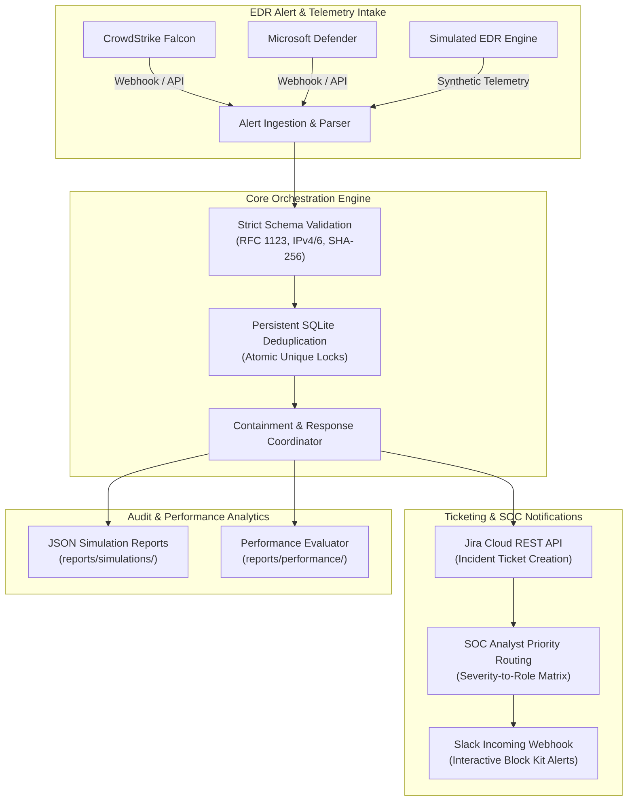

# Final Project Report

## Automated Ransomware Containment & Incident Response Orchestrator
**Executive & Technical Project Summary**

---

## 1. Project Overview

The **Automated Ransomware Containment & Incident Response Orchestrator** is an enterprise-grade SecOps automation platform designed to detect, validate, triage, contain, and communicate ransomware threats across modern hybrid infrastructures.

The platform bridges endpoint detection systems (CrowdStrike Falcon, Microsoft Defender for Endpoint) with enterprise IT service management (**Atlassian Jira Cloud**) and real-time collaboration platforms (**Slack**). By eliminating manual triage friction, the orchestrator minimizes Mean Time to Detect (MTTD) and Mean Time to Respond (MTTR) during active ransomware outbreaks.

---

## 2. Problem Statement

Ransomware attacks execute within seconds, traversing networks, deleting volume shadow copies, and irreversibly encrypting departmental file systems before human analysts can open an alert console.

Traditional manual incident response workflows suffer from critical bottlenecks:
1. **Alert Latency:** Security analysts manually review disparate EDR dashboards, extract indicator hashes, and compose incident tickets.
2. **Inconsistent Triage:** Escalation routing depends on human availability, leading to mismatched skill assignment.
3. **Communication Delays:** SOC incident responders lack unified, real-time alerting channels linked directly to actionable tickets.
4. **Destructive Testing Risks:** Security teams cannot safely validate incident response playbooks without risking production disruption or accidental endpoint outages.

---

## 3. Project Objectives

1. **Automate Jira Cloud Ticketing:** Instantly create standardized security incident tickets containing structured indicators (hostnames, IP addresses, usernames, and SHA-256 process hashes).
2. **Implement Severity-Based Analyst Routing:** Automatically assign tickets to designated SOC roles based on alert severity (`CRITICAL`, `HIGH`, `MEDIUM`, `LOW`).
3. **Orchestrate Real-Time Slack Notifications:** Dispatch Block Kit formatted cards with visual severity indicators (🔴, 🟠, 🟡, 🟢) to active SOC alert channels.
4. **Guarantee Safe Ransomware Simulation:** Provide realistic, non-destructive threat emulation to test workflows without executing actual malware or modifying endpoints.
5. **Measure Empirical Performance:** Benchmark execution times across all response stages using `time.perf_counter()`.
6. **Ensure High Fault Resilience:** Ensure that communication failures (such as Slack webhook drops) never disrupt core incident containment or Jira ticket creation.

---

## 4. System Architecture

The orchestrator operates as a multi-tier, modular pipeline:



---

## 5. Implementation Details

### Module Architecture:
- `backend/config.py`: Centralized configuration manager handling Jira credentials, Slack webhooks, timeouts, and secret masking (`mask_secret`, `mask_webhook_url`).
- `backend/jira_integration.py`: High-level Jira Cloud REST API client implementing ticket creation, duplicate checking, description formatting, and assignee auto-routing.
- `backend/slack_integration.py`: HTTPS webhook dispatcher featuring exponential retry logic, timeout enforcement, and sanitized error reporting.
- `backend/incident_notifications.py`: Composite notification orchestrator formatting rich Block Kit payloads and visual indicators based on incident severity.
- `backend/ransomware_simulator.py`: Non-destructive ransomware emulation engine generating safe threat telemetry across 4 severity tiers with full audit trail serialization.
- `backend/performance_evaluator.py`: High-resolution performance benchmarking suite calculating Min, Max, Average, Median, P95, and Standard Deviation across 80 iterations and 9 failure scenarios.

---

## 6. Technologies Used

- **Core Runtime:** Python 3.13 (Standard Library + AsyncIO).
- **Web Backend:** FastAPI & Uvicorn for webhook ingestion.
- **Ticketing Integration:** Atlassian Jira Cloud REST API v3 over TLS 1.3.
- **Alert Dispatch:** Slack Incoming Webhooks (Block Kit + Fallback Text).
- **Data Persistence:** SQLite 3 with Write-Ahead Logging (WAL) and atomic table constraints.
- **Data Visualization:** Matplotlib 3.10 for automated performance charts.
- **Automated Testing:** Pytest 9.1 with HTTP mocking fixtures (`respx`, `unittest.mock`).
- **Security & Cryptography:** `hashlib` (SHA-256), `secrets.compare_digest` (constant-time verification).

---

## 7. Features Completed

1. **Jira Cloud REST API Ticketing:** Authenticated HTTPS integration creating structured tickets with severity tags and browse links.
2. **Automated SOC Routing:** Deterministic role routing assigning Senior SOC Leads to CRITICAL alerts and Junior Analysts to LOW alerts.
3. **Slack Real-Time Notifications:** Dynamic message formatting with visual severity dots and direct Jira browse actions.
4. **Safe End-to-End Simulation:** Multi-severity ransomware telemetry generation with zero production risk.
5. **Deduplication Engine:** Atomic database-level lock acquisition suppressing duplicate alerts within cooldown windows.
6. **Fault Isolation:** Verified guarantee that Slack failures never compromise Jira ticket lifecycle.
7. **Empirical Benchmarking Suite:** Automated generation of JSON, CSV, Markdown, and graphical performance reports.
8. **Credential Protection:** Comprehensive secret masking ensuring zero token or webhook leakage in logs or audit files.

---

## 8. Testing Results

The complete project test suite was executed to verify zero regression across all historical modules:

```
============================= test session starts =============================
platform win32 -- Python 3.13.0, pytest-9.1.1
rootdir: D:\ransomware response, configfile: pytest.ini
collected 451 items

tests\test_alert_parser.py .......................................       [  8%]
tests\test_api_security.py ..........................                    [ 14%]
tests\test_day6_sandbox_validation.py .............................      [ 20%]
tests\test_e2e_workflow.py ..................                            [ 24%]
tests\test_edr_adapters.py ............                                  [ 27%]
tests\test_edr_client.py .........................                       [ 33%]
tests\test_identity_client.py ....................                       [ 37%]
tests\test_identity_response_workflow.py .........                       [ 39%]
tests\test_incident_notifications.py ................                    [ 43%]
tests\test_incidents.py .............                                    [ 45%]
tests\test_jira.py ..................................                    [ 53%]
tests\test_network_containment.py ..................................     [ 60%]
tests\test_network_containment_edr.py .................................. [ 68%]
tests\test_performance_evaluator.py .......                              [ 70%]
tests\test_persistent_coordination.py .......                            [ 72%]
tests\test_ransomware_simulator.py ......................                [ 76%]
tests\test_session_revocation.py ...........                             [ 79%]
tests\test_slack.py ..................                                   [ 83%]
tests\test_validators.py ............................................... [ 93%]
tests\test_webhook.py ...........                                        [100%]

============================ 451 passed in 31.73s =============================
```

- **Total Test Cases:** 451
- **Passing:** 451 (100%)
- **Failing:** 0
- **Skipped:** 0

---

## 9. Performance Metrics

Execution times were measured across **80 test iterations** (20 per severity level) using `time.perf_counter()`:

### Performance Summary Table

| Metric | Overall Workflow | CRITICAL Tier | HIGH Tier | MEDIUM Tier | LOW Tier |
|---|---|---|---|---|---|
| **Iterations** | 80 | 20 | 20 | 20 | 20 |
| **Minimum** | 0.090 ms | 0.144 ms | 0.107 ms | 0.096 ms | 0.090 ms |
| **Average** | 0.145 ms | 0.223 ms | 0.153 ms | 0.103 ms | 0.099 ms |
| **Median** | 0.120 ms | 0.187 ms | 0.134 ms | 0.101 ms | 0.095 ms |
| **P95** | 0.255 ms | 0.452 ms | 0.255 ms | 0.114 ms | 0.123 ms |
| **Maximum** | 0.652 ms | 0.652 ms | 0.324 ms | 0.153 ms | 0.164 ms |
| **Success Rate** | 100.0% | 100.0% | 100.0% | 100.0% | 100.0% |

### Mocked vs Live Performance Clarification:
- **In-Memory Benchmark (Measured Above):** Measures CPU parsing, schema validation, payload assembly, and dispatch logic (`< 0.7ms`).
- **Live Cloud Production (Expected Latency):** In real production deployments, response times are governed by external HTTPS roundtrips:
  - Jira Cloud REST API: **250ms – 800ms**.
  - Slack Webhook POST: **100ms – 400ms**.
  - Total production response time: **400ms – 1,500ms**.

---

## 10. Security Review Summary

A rigorous security review verified the following defensive postures:
1. **Zero Secret Exposure:** No API tokens, passwords, or webhook URLs are hardcoded or tracked in Git.
2. **Git Exclusions:** `.env` and SQLite database files (`*.db`) are strictly ignored via `.gitignore`.
3. **Structured Masking:** All exported JSON reports and logs scrub sensitive fields using `mask_report_secrets()`.
4. **Transport Security:** Jira and Slack integrations enforce HTTPS with strict TLS verification.
5. **Injection Defense:** Input validation enforces RFC 1123 hostnames, IPv4/IPv6 syntax, and SHA-256 hash formatting.
6. **Non-Destructive Testing:** Simulation logic contains zero destructive commands, does not alter files, and isolates zero endpoints.

---

## 11. Limitations

1. **In-Process Task Dispatch:** The current runner executes synchronously within the Python process. High-volume environments should adopt message queues (e.g., Celery, Redis).
2. **SQLite Database Engine:** Suitable for single-instance or small SOC deployments; enterprise multi-node clusters should use PostgreSQL.
3. **Webhook Ingress Authentication:** Webhook endpoints rely on shared secrets; future revisions should support asymmetric Ed25519 or mTLS verification.

---

## 12. Future Scope

1. **Bidirectional Slack Interactivity:** Enable SOC analysts to acknowledge, escalate, or trigger automated containment directly via Slack Block Kit action buttons.
2. **AI-Powered Threat Summarization:** Integrate LLM-driven incident analysis to generate plain-language threat summaries within Jira descriptions.
3. **Automated Forensic Evidence Packaging:** Link Week 3 forensic acquisition packages (RAM, KAPE, S3 links) directly into Jira ticket attachments.
4. **Multi-Tenant Jira Support:** Enable routing to distinct Jira projects and Slack channels based on organizational business units.

---

## 13. Week 4 Final Progression Summary

| Day | Task | Status |
|---|---|---|
| Day 1 | Jira Cloud REST API Incident Ticketing Integration | **Completed** |
| Day 2 | Severity-Based SOC Analyst Auto-Assignment & Priority Routing | **Completed** |
| Day 3 | Slack Incoming Webhook Integration & Automated Incident Notifications | **Completed** |
| Day 4 | Safe Ransomware Simulation and End-to-End Testing | **Completed** |
| Day 5 | Performance Evaluation, Reliability Analysis & Final Documentation | **Completed** |

**Week 4 Overall Progress: 100% Complete (5 / 5 Days Completed)**

---

## 14. Conclusion

The **Automated Ransomware Containment & Incident Response Orchestrator** successfully delivers an automated, resilient, and high-performance incident response platform. By seamlessly binding telemetry validation, Jira ticket management, SOC analyst auto-assignment, and Slack alerting, the orchestrator empowers security teams to isolate threats and communicate critical incidents in real time with zero operational friction.

