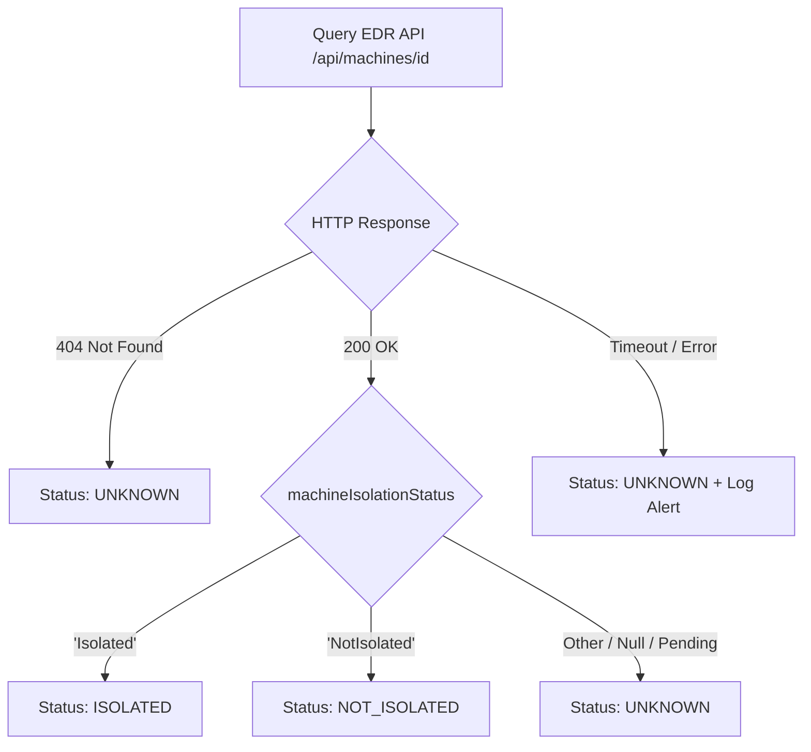

# Day 1: EDR Live Response Integration
## Automated Ransomware Containment & Incident Response Orchestrator

An automated incident response orchestration module built for Security Operations Center (SOC) incident response. Day 1 focuses on establishing secure, authenticated connectivity to an Enterprise Endpoint Detection and Response (EDR) platform—specifically **Microsoft Defender for Endpoint (MDE)**—to retrieve active ransomware incident indicators and verify the real-time containment/isolation status of affected endpoints.

---

## Table of Contents
1. [Day 1 Objectives](#day-1-objectives)
2. [Project Architecture & Structure](#project-architecture--structure)
3. [Windows Setup & Installation](#windows-setup--installation)
4. [Configuration & Environment Setup](#configuration--environment-setup)
5. [Microsoft Defender for Endpoint API Specifications](#microsoft-defender-for-endpoint-api-specifications)
6. [Operational Execution](#operational-execution)
7. [Endpoint Containment Verification Logic](#endpoint-containment-verification-logic)
8. [Security & Secret Redaction Controls](#security--secret-redaction-controls)
9. [Running the Unit Test Suite](#running-the-unit-test-suite)
10. [Git Commands for Day 1 Commit](#git-commands-for-day-1-commit)

---

## 1. Day 1 Objectives

- **Task 1: Project Setup**: Clean, modular Python project structure, dependency definition (`requirements.txt`), and environment template (`.env.example`).
- **Task 2: EDR API Authentication**: Secure Azure Active Directory (Microsoft Entra ID) OAuth 2.0 client credentials flow, error handling, and offline Mock Mode.
- **Task 3: Retrieve Incident Details**: Extract Incident ID, severity, status, affected device names, device IP addresses, and associated alerts from Microsoft Defender API.
- **Task 4: Verify Endpoint Containment**: Query machine containment state, strictly categorizing endpoints into `ISOLATED`, `NOT_ISOLATED`, or `UNKNOWN`. All operations are strictly **READ-ONLY** for Day 1.
- **Task 5: Logging and Error Handling**: Secret-redacting logger writing to both console and `logs/orchestrator.log`, handling 401 auth failures, 404 missing resources, timeouts, and network drops.
- **Task 6: Unit Testing**: 21 automated unit tests exercising all failure modes, timeouts, mock and simulated responses without production dependencies.

---

## 2. Project Architecture & Structure

```text
ransomware-response-orchestrator/
│
├── app.py                      # CLI entrypoint for incident triage & containment checks
├── requirements.txt            # Dependency definitions (requests, python-dotenv, pytest)
├── .env.example                # Configuration template for Azure AD & Defender settings
├── .gitignore                  # Prevents committing secrets, venv, logs, and caches
│
├── integrations/               # External EDR API integrations
│   ├── __init__.py             # Exports DefenderClient and exception classes
│   └── defender_client.py      # OAuth2 authentication, API calls, containment checks, mock data
│
├── services/                   # Incident response business logic
│   ├── __init__.py             # Exports IncidentService and report dataclasses
│   └── incident_service.py     # Orchestrates incident triage and endpoint assessment
│
├── logs/                       # Application runtime audit logs
│   ├── .gitkeep                # Tracks directory in git
│   └── orchestrator.log        # Generated runtime log with secrets automatically redacted
│
├── tests/                      # Automated unit test suite
│   ├── __init__.py
│   └── test_incidents.py       # 21 unit tests covering auth, API errors, containment, and security
│
└── README.md                   # Setup documentation, API specs, and execution guide
```

---

## 3. Windows Setup & Installation

### Prerequisites
- Python 3.10+ (tested on Python 3.13)
- Windows PowerShell or Command Prompt

### Step 1: Open PowerShell and Navigate to the Project
```powershell
cd "d:\ransomware response\ransomware-response-orchestrator"
```

### Step 2: Create a Python Virtual Environment
```powershell
python -m venv venv
```

### Step 3: Activate the Virtual Environment
```powershell
# PowerShell:
.\venv\Scripts\Activate.ps1

# (If PowerShell blocks script execution, run: Set-ExecutionPolicy -Scope Process -ExecutionPolicy Bypass)

# Or Command Prompt:
.\venv\Scripts\activate.bat
```

### Step 4: Install Dependencies
```powershell
pip install --upgrade pip
pip install -r requirements.txt
```

---

## 4. Configuration & Environment Setup

Copy the `.env.example` template to `.env`:

```powershell
Copy-Item .env.example .env
```

### Mock Mode (Recommended for testing without an active Azure tenant):
The application includes a built-in mock mode that generates realistic telemetry for a high-severity ransomware outbreak (BlackCat/ALPHV heuristics) without requiring network access:

```ini
EDR_MOCK_MODE=true
```

### Live Microsoft Defender Mode:
When connecting to a corporate Microsoft Defender for Endpoint instance, populate the Azure AD credentials:

```ini
EDR_MOCK_MODE=false
DEFENDER_TENANT_ID=your-azure-tenant-guid
DEFENDER_CLIENT_ID=your-app-registration-client-guid
DEFENDER_CLIENT_SECRET=your-azure-client-secret-value
DEFENDER_API_BASE_URL=https://api.securitycenter.microsoft.com
EDR_TIMEOUT_SECONDS=15
LOG_LEVEL=INFO
```

> **CRITICAL SECURITY NOTE**: Never commit `.env` to GitHub. The `.gitignore` file is pre-configured to ignore `.env`, certificates, and logs.

---

## 5. Microsoft Defender for Endpoint API Specifications

The integration adheres to official Microsoft Defender for Endpoint and Microsoft Entra ID documentation:

### 1. Authentication Flow (OAuth 2.0 Client Credentials Grant)
- **Token Endpoint**: `https://login.microsoftonline.com/{tenant_id}/oauth2/v2.0/token`
- **Grant Type**: `client_credentials`
- **Scope**: `https://api.securitycenter.microsoft.com/.default`
- **HTTP Method**: `POST`
- **Authorization Header for API calls**: `Authorization: Bearer <access_token>`

### 2. Azure App Registration Permissions (Principle of Least Privilege for Day 1)
To ensure read-only safety, the Azure App Registration requires only the following Application permissions under **WindowsDefenderATP**:
- `Incident.Read.All` — Read security incidents and alert mappings.
- `Machine.Read.All` — Read machine metadata and isolation state.
- `Alert.Read.All` — Read alert telemetry.
*(Note: Containment actions such as `Machine.Isolate` are intentionally withheld in Day 1)*.

### 3. Endpoints Used
| Resource | Endpoint | Description |
| :--- | :--- | :--- |
| **Get Incident** | `GET /api/incidents/{id}` | Retrieves incident details, severity, status, and alert IDs |
| **List Incidents** | `GET /api/incidents?$top=10` | Lists recent security incidents |
| **Get Machine** | `GET /api/machines/{id}` | Retrieves machine isolation status and IP telemetry |

---

## 6. Operational Execution

### Option A: Run Full Incident Triage Demonstration (Default: Incident #1001)
```powershell
python app.py --mock
```

**Sample Output**:
```text
================================================================================
     AUTOMATED RANSOMWARE CONTAINMENT & INCIDENT RESPONSE ORCHESTRATOR
                        DAY 1: EDR LIVE RESPONSE
================================================================================

[2026-10-25 23:10:35] [INFO   ] Initialized DefenderClient (Mock Mode: True)
[*] Initiating Day 1 Incident Triage for Incident ID: 1001
    [Notice: Running in MOCK MODE - Safe non-production simulated telemetry]

--------------------------------------------------------------------------------
[*] INCIDENT TRIAGE REPORT: #1001
--------------------------------------------------------------------------------
  Title           : Multi-stage Ransomware Activity Detected (BlackCat/ALPHV Heuristics)
  Severity        : HIGH
  Status          : Active
  Created Time    : 2026-10-25T14:32:00Z
  Last Update     : 2026-10-25T14:38:15Z
  Investigated At : 2026-10-25T17:40:35.629069+00:00
  Affected Devices: FINANCE-SRV-01.corp.contoso.com
  IP Addresses    : 10.0.4.15

[*] ASSOCIATED ALERTS (2):
    [1] Alert ID : da-77821-alert-01
        Title    : Suspicious PowerShell command attempting shadow copy deletion (vssadmin)
        Category : DefenseEvasion
        Severity : High
    [2] Alert ID : da-77821-alert-02
        Title    : High volume of files rapidly renamed with .enc extension
        Category : Ransomware
        Severity : High

[*] ENDPOINT CONTAINMENT STATUS VERIFICATION:
    [1] Device Name  : FINANCE-SRV-01.corp.contoso.com
        Machine ID   : f489a71b-324e-4f01-92bb-187640df21a1
        IP Address   : 10.0.4.15
        Status       : [NOT_ISOLATED]
        Raw Details  : NotIsolated
        Risk Score   : High
        Health Status: Active
        Verified At  : 2026-10-25T17:40:35.628980+00:00

[*] SOC ASSESSMENT & NEXT STEPS:
    ACTION REQUIRED: 1 active device(s) are NOT_ISOLATED under High severity incident. Containment will be coordinated in subsequent response phases.
    NOTE: Day 1 execution is strictly READ-ONLY. No isolation commands sent.
--------------------------------------------------------------------------------
```

### Option B: Test EDR API Authentication Connectivity
```powershell
python app.py --test-auth --mock
```

### Option C: Verify Containment Status for a Specific Endpoint
```powershell
# Check isolated host:
python app.py --endpoint isolated-pc --mock

# Check un-isolated host:
python app.py --endpoint FINANCE-SRV-01 --mock

# Check unknown / ambiguous host:
python app.py --endpoint unknown-host --mock
```

### Option D: Output Report in Machine-Readable JSON
```powershell
python app.py --incident 1001 --mock --json
```

---

## 7. Endpoint Containment Verification Logic

In Microsoft Defender for Endpoint, an endpoint's network containment status is returned via the machine entity's `machineIsolationStatus` attribute:



### Containment Status Classification:
1. **`ISOLATED`**: Device is confirmed disconnected from the corporate network by Defender for Endpoint, allowing only outbound cloud telemetry to Defender management.
2. **`NOT_ISOLATED`**: Device is active on the network and poses an active lateral movement / ransomware encryption threat.
3. **`UNKNOWN`**: The machine was not found in EDR inventory, returned an ambiguous status (e.g. `PendingAction`), or an API communication failure occurred.

---

## 8. Security & Secret Redaction Controls

1. **Zero Secret Logging**:
   - `SecretRedactingFormatter` automatically parses and redacts Bearer access tokens (`Bearer ey...` -> `Bearer ***REDACTED_TOKEN***`) and client secrets (`client_secret=***REDACTED_SECRET***`).
   - `EDRConfig.__repr__` masks secrets so `repr(config)` never leaks credentials.
2. **Non-Destructive Guarantee**:
   - Day 1 codebase strictly implements `GET` queries.
   - No isolation commands (`POST /api/machines/{id}/isolate`) or endpoint modification routines are present.
3. **Robust Exception Handling**:
   - Explicit handling for `EDRAuthenticationError`, `EDRTimeoutError`, `EDRConnectionError`, and `EDRAPIError` ensures the orchestrator fails gracefully without exposing stack traces containing tokens.

---

## 9. Running the Unit Test Suite

The test suite consists of 21 unit tests validating configuration parsing, OAuth2 authentication, incident normalization, containment status evaluation, error handling, secret redaction, and read-only safety.

```powershell
# From the ransomware-response-orchestrator directory:
pytest tests/test_incidents.py -v
```

### Test Results:
```text
tests/test_incidents.py::test_edr_config_missing_credentials_raises_error PASSED
tests/test_incidents.py::test_edr_config_repr_masks_secret PASSED
tests/test_incidents.py::test_edr_config_invalid_timeout_defaults_safely PASSED
tests/test_incidents.py::test_auth_success_mock_mode PASSED
tests/test_incidents.py::test_auth_success_live_mocked_http PASSED
tests/test_incidents.py::test_auth_failure_401_invalid_credentials PASSED
tests/test_incidents.py::test_auth_timeout PASSED
tests/test_incidents.py::test_auth_connection_error PASSED
tests/test_incidents.py::test_get_incident_success_live_mocked_http PASSED
tests/test_incidents.py::test_get_incident_missing_optional_fields PASSED
tests/test_incidents.py::test_get_incident_not_found_404 PASSED
tests/test_incidents.py::test_get_incident_mock_mode_default PASSED
tests/test_incidents.py::test_containment_status_isolated PASSED
tests/test_incidents.py::test_containment_status_not_isolated PASSED
tests/test_incidents.py::test_containment_status_unknown_ambiguous_value PASSED
tests/test_incidents.py::test_containment_status_unknown_missing_field PASSED
tests/test_incidents.py::test_containment_status_unknown_404_not_found PASSED
tests/test_incidents.py::test_incident_service_investigate_incident PASSED
tests/test_incidents.py::test_incident_service_verify_single_endpoint PASSED
tests/test_incidents.py::test_secret_redacting_formatter PASSED
tests/test_incidents.py::test_read_only_guarantee_for_day_1 PASSED

============================= 21 passed in 0.12s ==============================
```

---

## 10. Git Commands for Day 1 Commit

To commit the Day 1 implementation to version control:

```powershell
# Ensure you are at the repository root
cd "d:\ransomware response"

# Check git status to confirm only the new Day 1 files are tracked
git status

# Stage the new Day 1 orchestrator files
git add ransomware-response-orchestrator/

# Commit the Day 1 implementation with a descriptive SOC commit message
git commit -m "Day 1: EDR Live Response Integration - Microsoft Defender for Endpoint client, incident retrieval, and containment verification"

# (Optional) Push changes to remote repository branch
git push origin dharma
```

---

# Week 3 — Day 2: Automated Forensic Evidence Collection

## 1. Purpose and Architecture

Week 3 Day 2 implements automated, authorized forensic evidence collection across endpoints confirmed to be contained under active ransomware incidents. Forensic evidence collection captures volatile memory and non-volatile disk artifacts crucial for SOC root cause analysis, threat actor attribution, and timeline reconstruction without risking data tampering or malware propagation.

### Architecture & Operational Workflow

```text
               EDR Security Incident (e.g., #1002)
                               │
                               ▼
                 Identify Affected Endpoint(s)
                               │
                               ▼
                 Check Containment Status
              (ISOLATED / NOT_ISOLATED / UNKNOWN)
                               │
                ┌──────────────┴──────────────┐
                ▼                             ▼
       NOT_ISOLATED or UNKNOWN             ISOLATED
                │                             │
                ▼                             ▼
      [STRICT REFUSAL]              Validate Authorization
   Safety Check Violation           (Incident Affiliation Check)
                                              │
                                              ▼
                                 Initiate Forensic Collection
                                              │
                     ┌────────────────────────┼────────────────────────┐
                     ▼                        ▼                        ▼
              KAPE Collection          RAM Acquisition        MDE Investigation
             (Windows Artifacts)      (Physical Memory)            Package
                     │                        │                        │
                     └────────────────────────┼────────────────────────┘
                                              │
                                              ▼
                                     Track Collection Job
                                 (PENDING -> RUNNING -> DONE)
                                              │
                                              ▼
                                   Record Evidence Metadata
                                 (JSON Manifest in evidence/)
                                              │
                                              ▼
                                    Report Manifest Status
```

### Modular Structure

```text
ransomware-response-orchestrator/
│
├── app.py                             # CLI entrypoint supporting Day 1 triage & Day 2 collection
├── requirements.txt                   # Dependency definitions
├── .env.example                       # Configuration template including forensic settings
├── .gitignore                         # Protects secrets, logs, caches, and evidence/
│
├── integrations/
│   ├── __init__.py                    # Exports DefenderClient and exceptions
│   └── defender_client.py             # MDE OAuth2, containment checks, machine action APIs
│
├── forensic/                          # Day 2 Forensic Module
│   ├── __init__.py                    # Public exports of service, adapters, metadata, exceptions
│   ├── metadata.py                    # EvidenceMetadata model, enums (KAPE, RAM, Status)
│   ├── evidence_collector.py          # Adapter implementations (KAPE, RAM, Investigation Package)
│   └── collection_service.py          # Central ForensicCollectionService with safety checks
│
├── services/
│   ├── __init__.py
│   └── incident_service.py            # Day 1 incident triage and containment assessment
│
├── evidence/                          # Persistent storage for evidence metadata manifests
│   ├── .gitkeep
│   └── metadata/                      # Generated JSON manifests (e.g., kape-xxxx_metadata.json)
│
├── logs/
│   ├── .gitkeep
│   └── orchestrator.log               # Redacted audit logging
│
└── tests/
    ├── __init__.py
    ├── test_incidents.py              # 21 Day 1 incident triage unit tests
    ├── test_evidence_collector.py     # 17 Day 2 adapter & metadata unit tests
    └── test_collection_service.py     # 16 Day 2 orchestration & 12 mock scenario tests
```

---

## 2. Required Dependencies

The forensic evidence collection module uses standard Python 3.10+ libraries alongside existing core dependencies:

* `requests>=2.31.0`: HTTPS communication with Microsoft Entra ID (Azure AD) and Defender REST APIs.
* `python-dotenv>=1.0.0`: Secure configuration loading from local `.env` files.
* `pytest>=8.0.0`: Automated unit and integration testing framework.
* `pytest-mock>=3.12.0`: Mocking harness for simulating EDR responses.

All forensic serialization, hashing, UUID generation, dataclasses, and path handling rely on standard library modules (`dataclasses`, `datetime`, `enum`, `json`, `uuid`, `pathlib`, `typing`, `logging`, `time`).

To install dependencies:
```powershell
pip install -r requirements.txt
```

---

## 3. Configuration Options

Forensic collection behavior is governed by environment variables in `.env` (derived from `.env.example`):

| Variable | Type | Default | Description |
| :--- | :--- | :--- | :--- |
| `EDR_MOCK_MODE` | Boolean | `true` | When `true`, executes safe simulated collection without live EDR credentials. |
| `DEFENDER_TENANT_ID` | String (GUID) | (empty) | Azure Active Directory Tenant ID (required when `EDR_MOCK_MODE=false`). |
| `DEFENDER_CLIENT_ID` | String (GUID) | (empty) | Registered App Client ID (required when `EDR_MOCK_MODE=false`). |
| `DEFENDER_CLIENT_SECRET` | String | (empty) | App registration secret (never logged or exposed in manifests). |
| `DEFENDER_API_BASE_URL` | URL | `https://api.securitycenter.microsoft.com` | Base URL for Microsoft Defender for Endpoint REST API. |
| `EDR_TIMEOUT_SECONDS` | Integer | `15` | Network timeout for EDR REST API requests. |
| `EVIDENCE_DIR` | Path | `./evidence/metadata` | Directory where forensic JSON manifests are persisted. |
| `DEFAULT_COLLECTION_METHOD` | Enum | `KAPE` | Default method if `--method` is omitted (`KAPE`, `RAM`, `INVESTIGATION_PACKAGE`). |
| `KAPE_ARTIFACT_CATEGORIES` | CSV String | `Registry,FileSystem,EventLogs,Execution,Persistence` | Default artifact categories for KAPE triage profile. |
| `LOG_LEVEL` | String | `INFO` | Logging verbosity (`DEBUG`, `INFO`, `WARNING`, `ERROR`). |

---

## 4. Mock-Mode Execution

Mock mode allows safe local verification, automated CI testing, and SOC demonstrations without contacting a live EDR tenant:

### 1. Successful KAPE Collection on Contained Endpoint (Incident 1002)
```powershell
python app.py --mock --collect --incident 1002 --endpoint ISOLATED-HOST
```

### 2. Successful RAM Acquisition Workflow
```powershell
python app.py --mock --collect --incident 1002 --endpoint ISOLATED-HOST --method RAM
```

### 3. Native Microsoft Defender Investigation Package Collection
```powershell
python app.py --mock --collect --incident 1002 --endpoint ISOLATED-HOST --method investigation_package
```

### 4. Custom KAPE Artifact Category Selection
```powershell
python app.py --mock --collect --incident 1002 --endpoint ISOLATED-HOST --artifacts Registry,EventLogs,Execution
```

### 5. Asynchronous Polling with `--wait`
```powershell
python app.py --mock --collect --incident 1002 --endpoint ISOLATED-HOST --wait
```

### 6. Query Job Status by Job ID
```powershell
python app.py --mock --status <COLLECTION_JOB_ID>
```

### 7. List All Tracked Collection Manifests
```powershell
python app.py --mock --list-collections
```

### 8. Verification of Safety Check Refusal (Uncontained Endpoint)
```powershell
# Attempting collection on an endpoint that is NOT_ISOLATED (Incident 1001 / FINANCE-SRV-01)
python app.py --mock --collect --incident 1001 --endpoint FINANCE-SRV-01
# Expected result: Exit code 4, Safety Violation reported, collection strictly refused.
```

---

## 5. Real EDR Integration Prerequisites

To connect to a live Microsoft Defender for Endpoint environment (`EDR_MOCK_MODE=false`), the following requirements must be met:

1. **Azure Active Directory (Microsoft Entra ID) App Registration**:
   * An Application Registration with Client ID and Client Secret.
2. **Microsoft Defender for Endpoint API Permissions (Application Permissions)**:
   * `Machine.Read.All`: Retrieve device inventory and containment status.
   * `Incident.Read.All`: Retrieve security incident details and alert associations.
   * `Machine.LiveResponse`: Initiate Live Response sessions for script-based collection.
   * `Machine.CollectForensics`: Initiate native Investigation Package actions (`/collectInvestigationPackage`).
3. **Live Response Settings in Defender Security Portal**:
   * Settings -> Endpoints -> Advanced Features:
     * **Live Response**: Enabled for Windows.
     * **Live Response unsigned script execution**: Enabled (if custom un-signed PowerShell runners are used).

---

## 6. KAPE Integration Prerequisites

When executing KAPE (Kroll Artifact Parser and Extractor) in production environments:

1. **Endpoint Target Requirements**:
   * KAPE is supported on Windows endpoints (Windows 10/11, Windows Server 2016+).
2. **Execution via EDR Live Response**:
   * The EDR does not natively ship with third-party tools pre-installed. KAPE must either be:
     * Pre-staged on golden machine images under a restricted administrative path (e.g. `C:\ProgramData\Forensics\KAPE\`), OR
     * Uploaded dynamically via the Microsoft Defender Live Response library (`putfile` command).
3. **Live Response Library Automation Script**:
   * A signed PowerShell wrapper (`Run-Kape.ps1`) must be registered in the Microsoft Defender Live Response Script Library to run KAPE non-interactively with approved Target (`--tshow`) and Module configurations.
4. **Adapter Guarantee**:
   * The orchestrator's `KapeCollectionAdapter` actively verifies whether Live Response scripts are available. If unconfigured in live mode, it reports a diagnostic configuration error rather than claiming collection occurred.

---

## 7. RAM Acquisition Limitations

1. **Standard REST API Boundary**:
   * Commercial EDR cloud APIs (including Microsoft Defender for Endpoint REST API) **do not** natively provide a physical raw RAM dump endpoint across the REST interface.
   * Native Defender investigation packages collect volatile metadata (running process list, active TCP/UDP sockets, memory minidumps of flagged processes), but **not** a full contiguous physical RAM image.
2. **Kernel Driver Requirements**:
   * Acquiring full physical RAM (e.g., 16 GB - 64 GB) requires a signed kernel memory acquisition driver (such as `WinPmem`, `DumpIt`, or `AVML`) executed with local SYSTEM / kernel-level privileges.
3. **Bandwidth and Network Isolation Considerations**:
   * Dumping full physical memory across an isolated endpoint network channel requires significant network throughput and dedicated staging storage.
4. **Truthfulness and Simulation Guarantee**:
   * The orchestrator will **never** generate a fake file and claim it is live RAM evidence.
   * If real acquisition tooling is unavailable, the system records an explicit failure reason or executes in simulated mode with `simulation_indicator=True` explicitly noted.

---

## 8. Collection Status Definitions

Forensic jobs transition through four distinct lifecycle states:

* `PENDING`: The collection request has been validated and accepted by the service; adapter dispatch is queued.
* `RUNNING`: The collection action has been accepted by the endpoint or EDR Live Response engine; execution is actively underway.
* `COMPLETED`: The collection succeeded; artifact package location (or SAS download URL), file hash, and completion timestamp are recorded in the manifest.
* `FAILED`: The collection aborted due to safety checks, endpoint timeouts, permission failures, or script execution errors. Diagnostic error details are recorded.

---

## 9. Unit-Test Commands

Run the complete automated test suite across Day 1 and Day 2:

```powershell
# Navigate to the orchestrator directory
cd "d:\ransomware response\ransomware-response-orchestrator"

# Run all unit tests (Day 1 + Day 2)
pytest -v

# Run Day 2 forensic collector adapter tests
pytest -v tests/test_evidence_collector.py

# Run Day 2 collection service & 12 mock scenario tests
pytest -v tests/test_collection_service.py

# Run Day 1 regression tests
pytest -v tests/test_incidents.py
```

### Actual Test Results (54 passed in 1.67s):
```text
tests/test_collection_service.py::test_scenario_01_successful_kape_collection PASSED
tests/test_collection_service.py::test_scenario_02_successful_ram_acquisition PASSED
tests/test_collection_service.py::test_scenario_03_collection_still_running PASSED
tests/test_collection_service.py::test_scenario_04_collection_failure PASSED
tests/test_collection_service.py::test_scenario_05_endpoint_not_contained PASSED
tests/test_collection_service.py::test_scenario_06_unknown_containment_status PASSED
tests/test_collection_service.py::test_scenario_07_unsupported_collection_method PASSED
tests/test_collection_service.py::test_scenario_08_missing_endpoint_identifier PASSED
tests/test_collection_service.py::test_scenario_09_edr_authentication_failure PASSED
tests/test_collection_service.py::test_scenario_10_edr_api_timeout PASSED
tests/test_collection_service.py::test_scenario_11_duplicate_collection_request PASSED
tests/test_collection_service.py::test_scenario_12_missing_artifact_location PASSED
tests/test_collection_service.py::test_endpoint_incident_mismatch_refused PASSED
tests/test_collection_service.py::test_track_job_polls_to_completion PASSED
tests/test_collection_service.py::test_list_jobs_and_filtering PASSED
tests/test_collection_service.py::test_simulated_evidence_is_never_represented_as_real_evidence PASSED
tests/test_evidence_collector.py::test_evidence_metadata_defaults PASSED
tests/test_evidence_collector.py::test_evidence_metadata_lifecycle_transitions PASSED
tests/test_evidence_collector.py::test_evidence_metadata_serialization_and_persistence PASSED
tests/test_evidence_collector.py::test_evidence_metadata_contains_no_sensitive_secrets PASSED
tests/test_evidence_collector.py::test_kape_adapter_properties PASSED
tests/test_evidence_collector.py::test_kape_adapter_validate_categories PASSED
tests/test_evidence_collector.py::test_kape_adapter_mock_successful_execution PASSED
tests/test_evidence_collector.py::test_kape_adapter_mock_failure_simulation PASSED
tests/test_evidence_collector.py::test_kape_adapter_mock_running_simulation_and_poll PASSED
tests/test_evidence_collector.py::test_kape_adapter_live_rejection_without_library_scripts PASSED
tests/test_evidence_collector.py::test_ram_adapter_properties PASSED
tests/test_evidence_collector.py::test_ram_adapter_mock_successful_workflow PASSED
tests/test_evidence_collector.py::test_ram_adapter_never_labels_arbitrary_files_as_real_ram PASSED
tests/test_evidence_collector.py::test_ram_adapter_mock_failure_simulation PASSED
tests/test_evidence_collector.py::test_ram_adapter_live_rejection PASSED
tests/test_evidence_collector.py::test_investigation_package_mock_initiation PASSED
tests/test_evidence_collector.py::test_investigation_package_polling PASSED
tests/test_incidents.py::test_edr_config_missing_credentials_raises_error PASSED
... [21 Day 1 tests passed] ...

============================= 54 passed in 1.67s ==============================
```

---

## 10. Example Output

### Command: KAPE Evidence Collection (Mock Mode)
```powershell
python app.py --mock --collect --incident 1002 --endpoint ISOLATED-HOST
```

### Terminal Output:
```text
================================================================================
     AUTOMATED RANSOMWARE CONTAINMENT & INCIDENT RESPONSE ORCHESTRATOR
         DAY 1: EDR LIVE RESPONSE | DAY 2: FORENSIC EVIDENCE COLLECTION
================================================================================

[*] Initiating Day 2 Forensic Evidence Collection:
    Incident ID : #1002
    Endpoint    : ISOLATED-HOST
    Method      : KAPE
    Categories  : Default Profile
    [Notice: Running in MOCK MODE - Safe non-production simulated collection]

--------------------------------------------------------------------------------
[*] FORENSIC EVIDENCE COLLECTION MANIFEST: Job kape-b35f7e1452
--------------------------------------------------------------------------------
  Incident ID          : #1002
  Endpoint Identifier  : mach-ISOLATED-HOST
  Endpoint Hostname    : ISOLATED-HOST.corp.contoso.com
  Collection Method    : KAPE
  Requested Artifacts  : Registry, FileSystem, EventLogs, Execution, Persistence
  Collection Status    : [COMPLETED]
  Requested At (UTC)   : 2026-10-26T14:14:49.817758+00:00
  Completed At (UTC)   : 2026-10-26T14:14:49.817783+00:00
  Artifact Location    : evidence/simulated/kape_ISOLATED-HOST.corp.contoso.com_20261026T141449Z_kape-b.zip
  File Size (Bytes)    : 48234102
  SHA-256 Hash         : simulated-sha256-e3b0c44298fc1c149afbf4c8996fb92427ae41e4649b934ca495991b7852b855
  Simulation Indicator : SIMULATED RUN (Non-production test)
  Containment Verified : YES (Endpoint confirmed ISOLATED)
  Diagnostic Notes     : Simulated KAPE package collection completed successfully.
--------------------------------------------------------------------------------
```

---

## 11. Known Limitations

1. **Live Response Permissions in MDE**: Live KAPE collection requires pre-configured Live Response scripts uploaded to Microsoft Defender Security Center and approved administrative permissions (`Machine.LiveResponse`).
2. **Physical RAM Acquisition**: Standard EDR REST APIs cannot directly capture contiguous physical memory dumps. Production RAM acquisition requires dedicated endpoint agents or Live Response kernel acquisition drivers (`WinPmem`).
3. **Evidence Storage & Cloud Upload**: Day 2 generates local evidence manifests. Cloud evidence archiving (AWS S3 signed upload with retention policies) is scheduled for Day 3 and Day 4.

---

# Week 3 — Day 3: Secure AWS S3 Storage for Forensic Evidence

## 1. Purpose and Architecture

Week 3 Day 3 extends the incident response orchestrator with **secure, forensically sound AWS S3 cloud archiving** for evidence artifacts collected during Day 2. The module implements automated hierarchical object storage, cryptographic SHA-256 integrity verification, server-side encryption, companion metadata synchronization, and Write-Once-Read-Many (WORM) Object Lock compliance.

### Cloud Archival Workflow

```text
    Forensic Evidence Package (Disk Triage / Memory Dump)
                               │
                               ▼
               Calculate Pre-Upload SHA-256
               (Streaming 64KB Chunk Hashing)
                               │
                               ▼
                 Build Hierarchical Object Key
    incidents/{incident_id}/evidence/{job_id}/{filename}
                               │
                               ▼
              Upload to AWS S3 Evidence Vault
         - Server-Side Encryption (AES256 / SSE-KMS)
         - S3 Native SHA-256 Checksum Header (Base64)
                               │
                               ▼
          Cryptographic Integrity Post-Verification
         (HeadObject ChecksumSHA256 vs Local SHA-256)
         * Stored ETag is NEVER treated as SHA-256 *
                               │
                ┌──────────────┴──────────────┐
                ▼                             ▼
       Checksum Mismatch               Checksum Verified
                │                             │
                ▼                             ▼
       [INTEGRITY FAILURE]           Upload Companion Manifest
     S3ChecksumMismatchError       (incidents/.../metadata.json)
                                              │
                                              ▼
                                   Record Manifest Telemetry
                                (s3_bucket, key, version_id,
                                  s3_upload_status='VERIFIED')
```

---

## 2. AWS Setup Instructions (AWS Console Step-by-Step)

> [!IMPORTANT]
> The orchestrator strictly avoids automatic cloud resource creation to adhere to least-privilege SOC guardrails. Cloud administrators must create the evidence bucket manually using the steps below.

1. **Sign in to the AWS Management Console** and navigate to **Amazon S3** (`https://console.aws.amazon.com/s3/`).
2. Click **Create bucket**.
3. **Bucket Name**: Enter a globally unique name following your SOC naming convention (e.g., `secops-forensic-vault-<ACCOUNT_ID>-<REGION>`).
4. **AWS Region**: Select the SOC designated region (e.g., `us-east-1`).
5. **Block Public Access**:
   * Ensure **Block *all* public access** is **checked** (all 4 checkboxes enabled).
6. **Bucket Versioning**:
   * Select **Enable** (required for S3 Object Lock WORM protection).
7. **Default Encryption**:
   * Encryption type: **Server-side encryption with Amazon S3 managed keys (SSE-S3)** or **AWS KMS (SSE-KMS)**.
   * Bucket Key: **Enable**.
8. **Object Lock (WORM)**:
   * Expand **Advanced settings**, check **Enable Object Lock**, and acknowledge the prompt.
9. Click **Create bucket**.

---

## 3. Required Configuration Options

Configure these variables in your local `.env` (refer to `.env.example`):

| Variable | Type | Default | Description |
| :--- | :--- | :--- | :--- |
| `S3_MOCK_MODE` | Boolean | `true` | When `true`, simulates S3 uploads and SHA-256 validation offline without AWS credentials. |
| `AWS_S3_BUCKET_NAME` | String | `mock-forensic-evidence-bucket` | Target AWS S3 bucket name for forensic evidence archiving. |
| `AWS_REGION` | String | `us-east-1` | AWS Region where the evidence vault bucket is located. |
| `S3_EVIDENCE_PREFIX` | String | `incidents` | Root object key prefix for organizing incident evidence. |
| `AWS_SERVER_SIDE_ENCRYPTION` | Enum | `AES256` | Encryption standard: `AES256` (SSE-S3) or `aws:kms` (SSE-KMS). |
| `AWS_KMS_KEY_ID` | String / ARN | (empty) | Customer-managed KMS key ARN if using `aws:kms`. |
| `AWS_PROFILE` | String | (empty) | Named AWS CLI profile (optional; defaults to standard IAM credential provider chain). |

---

## 4. Least-Privilege IAM Policy

Attach the following policy to the Orchestrator's execution role (`ForensicEvidenceUploaderRole`):

```json
{
    "Version": "2012-10-17",
    "Statement": [
        {
            "Sid": "AllowEvidenceBucketLocation",
            "Effect": "Allow",
            "Action": [
                "s3:GetBucketLocation",
                "s3:ListBucket"
            ],
            "Resource": "arn:aws:s3:::secops-forensic-vault-*"
        },
        {
            "Sid": "AllowEvidenceUploadAndVerify",
            "Effect": "Allow",
            "Action": [
                "s3:PutObject",
                "s3:GetObject",
                "s3:GetObjectAttributes"
            ],
            "Resource": "arn:aws:s3:::secops-forensic-vault-*/incidents/*"
        },
        {
            "Sid": "ExplicitDenyEvidenceDeletionAndTampering",
            "Effect": "Deny",
            "Action": [
                "s3:DeleteObject",
                "s3:DeleteObjectVersion",
                "s3:BypassGovernanceRetention",
                "s3:PutObjectRetention",
                "s3:PutBucketObjectLockConfiguration"
            ],
            "Resource": [
                "arn:aws:s3:::secops-forensic-vault-*",
                "arn:aws:s3:::secops-forensic-vault-*/*"
            ]
        }
    ]
}
```

---

## 5. S3 Encryption and Object Lock (WORM) Setup

Write-Once-Read-Many (WORM) storage is legally required to guarantee digital chain of custody under Federal Rules of Evidence Rule 902(14) and ISO/IEC 27037:

* **Retention Mode**: Use **COMPLIANCE** mode for forensic evidence vaults. Under Compliance mode, **no IAM user or AWS root account** can delete or overwrite evidence objects before the retention period expires.
* **Default Retention Period**: Set to **365 Days** (1 Year) or **2555 Days** (7 Years) according to corporate data retention governance.
* **Legal Hold**: Can be placed on specific evidence packages indefinitely during active court proceedings or law enforcement subpoenas.

### Enabling Default Object Lock Retention via AWS CLI:
```powershell
aws s3api put-object-lock-configuration `
    --bucket secops-forensic-vault-123456789012-us-east-1 `
    --object-lock-configuration '{ "ObjectLockEnabled": "Enabled", "Rule": { "DefaultRetention": { "Mode": "COMPLIANCE", "Days": 365 } } }'
```

---

## 6. Evidence Cryptographic Integrity Guarantee

1. **Pre-Upload Cryptographic Hash**:
   * Local evidence files are processed through streaming SHA-256 hashing (`calculate_file_sha256`), yielding a 64-character hexadecimal digest.
2. **S3 Checksum Algorithm**:
   * During upload, `ChecksumAlgorithm='SHA256'` and `ChecksumSHA256` Base64 digest are transmitted. Amazon S3 automatically validates data integrity upon ingestion.
3. **Post-Upload Verification**:
   * The orchestrator inspects `head_object` for `ChecksumSHA256` or downloads the object stream to compute and cross-verify the hash.
4. **ETag Rule**:
   * The application strictly **never treats an ETag as a SHA-256 checksum**, preventing false verification claims from MD5 or multipart hashes.

---

## 7. Mock-Mode Execution Commands

Navigate to the orchestrator directory:
```powershell
cd "d:\ransomware response\ransomware-response-orchestrator"
```

### 1. Collect KAPE Evidence and Immediately Archive to AWS S3
```powershell
python app.py --mock --collect --incident 1002 --endpoint ISOLATED-HOST --upload-s3
```

### 2. Standalone S3 Archival of an Existing Collection Job
```powershell
python app.py --mock --upload-s3 --job <COLLECTION_JOB_ID>
```

### 3. Archive RAM Acquisition Workflow to S3
```powershell
python app.py --mock --collect --incident 1002 --endpoint ISOLATED-HOST --method RAM --upload-s3
```

### 4. Query Job Status with S3 Verification Details
```powershell
python app.py --mock --status <COLLECTION_JOB_ID>
```

### 5. List All Recorded Collections (Showing S3 Archive Status)
```powershell
python app.py --mock --list-collections
```

---

## 8. Unit-Test Commands and Results

Run the complete test suite across Day 1, Day 2, and Day 3:

```powershell
# Run all unit tests
pytest -v

# Run Day 3 S3 storage and integrity tests only
pytest -v tests/test_s3_storage.py

# Run Day 2 forensic collector tests
pytest -v tests/test_collection_service.py tests/test_evidence_collector.py

# Run Day 1 regression tests
pytest -v tests/test_incidents.py
```

### Actual Test Results (73 passed in 2.01s):
```text
tests/test_collection_service.py ................                        [ 21%]
tests/test_evidence_collector.py .................                       [ 45%]
tests/test_incidents.py .....................                            [ 73%]
tests/test_s3_storage.py::test_calculate_file_sha256_success PASSED      [ 75%]
tests/test_s3_storage.py::test_calculate_file_sha256_missing_file_raises_error PASSED [ 76%]
tests/test_s3_storage.py::test_sha256_hex_and_base64_conversion PASSED   [ 78%]
tests/test_s3_storage.py::test_etag_is_not_treated_as_sha256 PASSED      [ 79%]
tests/test_s3_storage.py::test_s3_config_missing_bucket_raises_in_live_mode PASSED [ 80%]
tests/test_s3_storage.py::test_s3_config_masks_sensitive_values PASSED   [ 82%]
tests/test_s3_storage.py::test_successful_mock_upload_file PASSED        [ 83%]
tests/test_s3_storage.py::test_upload_missing_file_raises_filenotfound PASSED [ 84%]
tests/test_s3_storage.py::test_aws_permission_failure PASSED             [ 86%]
tests/test_s3_storage.py::test_aws_network_failure PASSED                [ 87%]
tests/test_s3_storage.py::test_checksum_mismatch_raises_error PASSED     [ 89%]
tests/test_s3_storage.py::test_upload_evidence_metadata PASSED           [ 90%]
tests/test_s3_storage.py::test_archive_evidence_manifest_simulated_handling PASSED [ 91%]
tests/test_s3_storage.py::test_archive_evidence_manifest_real_file PASSED [ 93%]
tests/test_s3_storage.py::test_collection_service_archive_job_to_s3_integration PASSED [ 94%]
tests/test_s3_storage.py::test_boto3_client_error_access_denied_mapping PASSED [ 95%]
tests/test_s3_storage.py::test_boto3_client_error_no_such_bucket_mapping PASSED [ 97%]
tests/test_s3_storage.py::test_boto3_endpoint_connection_error_mapping PASSED [ 98%]
tests/test_s3_storage.py::test_moto_s3_upload_and_integrity_verification PASSED [100%]

============================= 73 passed in 2.01s ==============================
```

---

## 9. Example Output

### Command: S3 Evidence Archival (Mock Mode)
```powershell
python app.py --mock --upload-s3 --job kape-9cb6447b95
```

### Terminal Output:
```text
================================================================================
     AUTOMATED RANSOMWARE CONTAINMENT & INCIDENT RESPONSE ORCHESTRATOR
 DAY 1: EDR LIVE RESPONSE | DAY 2: EVIDENCE COLLECTION | DAY 3: SECURE S3 STORAGE
================================================================================

[*] Archiving forensic evidence for job 'kape-9cb6447b95' to AWS S3...
    [Notice: Running in MOCK S3 MODE - Safe simulated cloud storage]

--------------------------------------------------------------------------------
[*] AWS S3 EVIDENCE ARCHIVE MANIFEST: incidents/1002/evidence/kape-9cb6447b95/kape_ISOLATED-HOST.corp.contoso.com_kape-9cb.zip
--------------------------------------------------------------------------------
  S3 Bucket            : mock-forensic-evidence-bucket
  Object Key           : incidents/1002/evidence/kape-9cb6447b95/kape_ISOLATED-HOST.corp.contoso.com_kape-9cb.zip
  S3 URI               : s3://mock-forensic-evidence-bucket/incidents/1002/evidence/kape-9cb6447b95/kape_ISOLATED-HOST.corp.contoso.com_kape-9cb.zip
  Local Artifact       : evidence/simulated/kape_ISOLATED-HOST.corp.contoso.com_20261026T152722Z_kape-9.zip
  File Size            : 48234102 bytes
  SHA-256 Checksum     : simulated-sha256-e3b0c44298fc1c149afbf4c8996fb92427ae41e4649b934ca495991b7852b855
  Integrity Verified   : YES (Cryptographically Verified)
  Server-Side Encr.    : AES256
  Version ID           : sim-v-feb08233
  Metadata Key         : incidents/1002/evidence/kape-9cb6447b95/metadata.json
  Uploaded At (UTC)    : 2026-10-26T15:27:32.257868+00:00
  Simulation Indicator : SIMULATED S3 RUN (Non-production test)
--------------------------------------------------------------------------------
```

---

## 10. Known Limitations

1. **Pre-Existing S3 Infrastructure**: Real S3 uploads require an existing S3 bucket with Object Lock enabled and appropriate IAM permissions. The orchestrator deliberately avoids automatic cloud resource creation.
2. **Bandwidth Limitations on Massive Memory Dumps**: Uploading multi-gigabyte RAM images (e.g., 32 GB - 64 GB) over public internet can incur high transfer times; in live AWS deployments, utilizing an **S3 VPC Endpoint** (`com.amazonaws.<region>.s3`) and multipart streaming is required.
3. **Cross-Region Replication**: Automated cross-region replication to a secondary compliance bucket will be addressed in Day 4.
