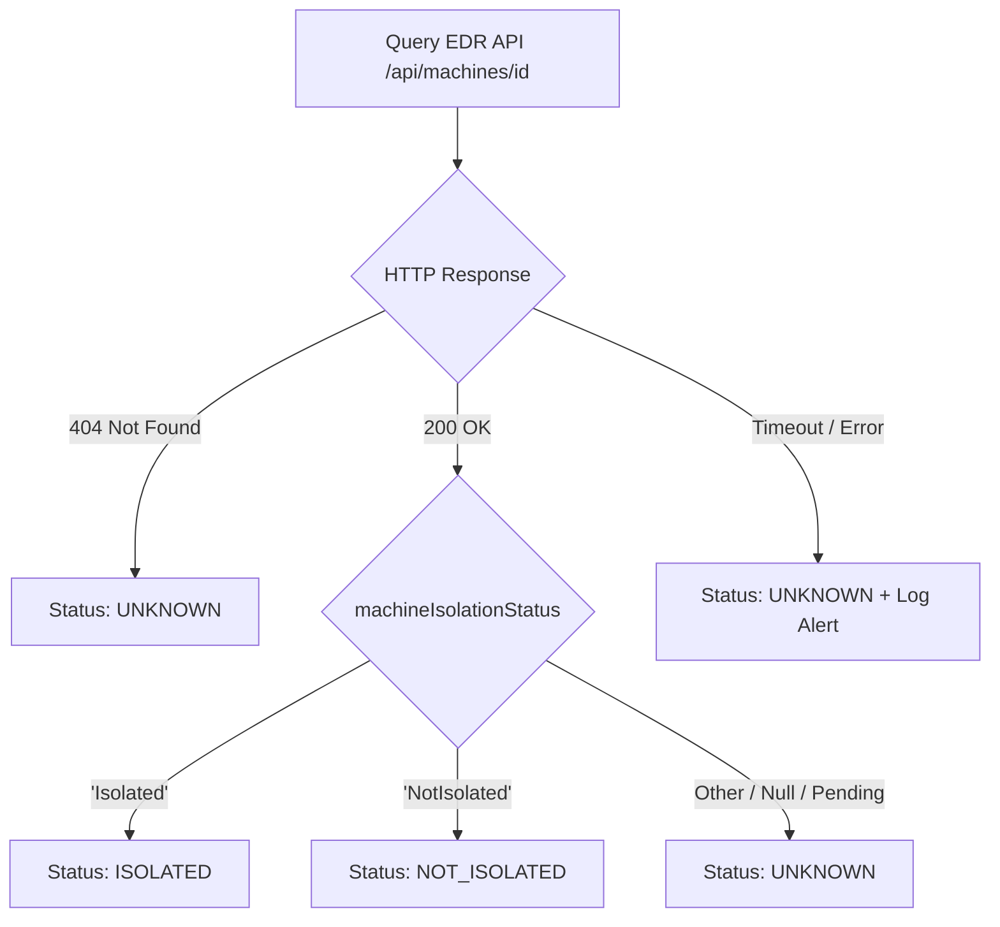

# Day 1: EDR Live Response Integration
## Automated Ransomware Containment & Incident Response Orchestrator

An automated incident response orchestration module built for Security Operations Center (SOC) incident response. Day 1 focuses on establishing secure, authenticated connectivity to an Enterprise Endpoint Detection and Response (EDR) platform—specifically **Microsoft Defender for Endpoint (MDE)**—to retrieve active ransomware incident indicators and verify the real-time containment/isolation status of affected endpoints.

---

## Table of Contents
1. [Day 1 Objectives](#day-1-objectives)
2. [Project Architecture & Structure](#project-architecture--structure)
3. [Windows Setup & Installation](#windows-setup--installation)
4. [Configuration & Environment Setup](#configuration--environment-setup)
5. [Microsoft Defender for Endpoint API Specifications](#microsoft-defender-for-endpoint-api-specifications)
6. [Operational Execution](#operational-execution)
7. [Endpoint Containment Verification Logic](#endpoint-containment-verification-logic)
8. [Security & Secret Redaction Controls](#security--secret-redaction-controls)
9. [Running the Unit Test Suite](#running-the-unit-test-suite)
10. [Git Commands for Day 1 Commit](#git-commands-for-day-1-commit)

---

## 1. Day 1 Objectives

- **Task 1: Project Setup**: Clean, modular Python project structure, dependency definition (`requirements.txt`), and environment template (`.env.example`).
- **Task 2: EDR API Authentication**: Secure Azure Active Directory (Microsoft Entra ID) OAuth 2.0 client credentials flow, error handling, and offline Mock Mode.
- **Task 3: Retrieve Incident Details**: Extract Incident ID, severity, status, affected device names, device IP addresses, and associated alerts from Microsoft Defender API.
- **Task 4: Verify Endpoint Containment**: Query machine containment state, strictly categorizing endpoints into `ISOLATED`, `NOT_ISOLATED`, or `UNKNOWN`. All operations are strictly **READ-ONLY** for Day 1.
- **Task 5: Logging and Error Handling**: Secret-redacting logger writing to both console and `logs/orchestrator.log`, handling 401 auth failures, 404 missing resources, timeouts, and network drops.
- **Task 6: Unit Testing**: 21 automated unit tests exercising all failure modes, timeouts, mock and simulated responses without production dependencies.

---

## 2. Project Architecture & Structure

```text
ransomware-response-orchestrator/
│
├── app.py                      # CLI entrypoint for incident triage & containment checks
├── requirements.txt            # Dependency definitions (requests, python-dotenv, pytest)
├── .env.example                # Configuration template for Azure AD & Defender settings
├── .gitignore                  # Prevents committing secrets, venv, logs, and caches
│
├── integrations/               # External EDR API integrations
│   ├── __init__.py             # Exports DefenderClient and exception classes
│   └── defender_client.py      # OAuth2 authentication, API calls, containment checks, mock data
│
├── services/                   # Incident response business logic
│   ├── __init__.py             # Exports IncidentService and report dataclasses
│   └── incident_service.py     # Orchestrates incident triage and endpoint assessment
│
├── logs/                       # Application runtime audit logs
│   ├── .gitkeep                # Tracks directory in git
│   └── orchestrator.log        # Generated runtime log with secrets automatically redacted
│
├── tests/                      # Automated unit test suite
│   ├── __init__.py
│   └── test_incidents.py       # 21 unit tests covering auth, API errors, containment, and security
│
└── README.md                   # Setup documentation, API specs, and execution guide
```

---

## 3. Windows Setup & Installation

### Prerequisites
- Python 3.10+ (tested on Python 3.13)
- Windows PowerShell or Command Prompt

### Step 1: Open PowerShell and Navigate to the Project
```powershell
cd "d:\ransomware response\ransomware-response-orchestrator"
```

### Step 2: Create a Python Virtual Environment
```powershell
python -m venv venv
```

### Step 3: Activate the Virtual Environment
```powershell
# PowerShell:
.\venv\Scripts\Activate.ps1

# (If PowerShell blocks script execution, run: Set-ExecutionPolicy -Scope Process -ExecutionPolicy Bypass)

# Or Command Prompt:
.\venv\Scripts\activate.bat
```

### Step 4: Install Dependencies
```powershell
pip install --upgrade pip
pip install -r requirements.txt
```

---

## 4. Configuration & Environment Setup

Copy the `.env.example` template to `.env`:

```powershell
Copy-Item .env.example .env
```

### Mock Mode (Recommended for testing without an active Azure tenant):
The application includes a built-in mock mode that generates realistic telemetry for a high-severity ransomware outbreak (BlackCat/ALPHV heuristics) without requiring network access:

```ini
EDR_MOCK_MODE=true
```

### Live Microsoft Defender Mode:
When connecting to a corporate Microsoft Defender for Endpoint instance, populate the Azure AD credentials:

```ini
EDR_MOCK_MODE=false
DEFENDER_TENANT_ID=your-azure-tenant-guid
DEFENDER_CLIENT_ID=your-app-registration-client-guid
DEFENDER_CLIENT_SECRET=your-azure-client-secret-value
DEFENDER_API_BASE_URL=https://api.securitycenter.microsoft.com
EDR_TIMEOUT_SECONDS=15
LOG_LEVEL=INFO
```

> **CRITICAL SECURITY NOTE**: Never commit `.env` to GitHub. The `.gitignore` file is pre-configured to ignore `.env`, certificates, and logs.

---

## 5. Microsoft Defender for Endpoint API Specifications

The integration adheres to official Microsoft Defender for Endpoint and Microsoft Entra ID documentation:

### 1. Authentication Flow (OAuth 2.0 Client Credentials Grant)
- **Token Endpoint**: `https://login.microsoftonline.com/{tenant_id}/oauth2/v2.0/token`
- **Grant Type**: `client_credentials`
- **Scope**: `https://api.securitycenter.microsoft.com/.default`
- **HTTP Method**: `POST`
- **Authorization Header for API calls**: `Authorization: Bearer <access_token>`

### 2. Azure App Registration Permissions (Principle of Least Privilege for Day 1)
To ensure read-only safety, the Azure App Registration requires only the following Application permissions under **WindowsDefenderATP**:
- `Incident.Read.All` — Read security incidents and alert mappings.
- `Machine.Read.All` — Read machine metadata and isolation state.
- `Alert.Read.All` — Read alert telemetry.
*(Note: Containment actions such as `Machine.Isolate` are intentionally withheld in Day 1)*.

### 3. Endpoints Used
| Resource | Endpoint | Description |
| :--- | :--- | :--- |
| **Get Incident** | `GET /api/incidents/{id}` | Retrieves incident details, severity, status, and alert IDs |
| **List Incidents** | `GET /api/incidents?$top=10` | Lists recent security incidents |
| **Get Machine** | `GET /api/machines/{id}` | Retrieves machine isolation status and IP telemetry |

---

## 6. Operational Execution

### Option A: Run Full Incident Triage Demonstration (Default: Incident #1001)
```powershell
python app.py --mock
```

**Sample Output**:
```text
================================================================================
     AUTOMATED RANSOMWARE CONTAINMENT & INCIDENT RESPONSE ORCHESTRATOR
                        DAY 1: EDR LIVE RESPONSE
================================================================================

[2026-10-25 23:10:35] [INFO   ] Initialized DefenderClient (Mock Mode: True)
[*] Initiating Day 1 Incident Triage for Incident ID: 1001
    [Notice: Running in MOCK MODE - Safe non-production simulated telemetry]

--------------------------------------------------------------------------------
[*] INCIDENT TRIAGE REPORT: #1001
--------------------------------------------------------------------------------
  Title           : Multi-stage Ransomware Activity Detected (BlackCat/ALPHV Heuristics)
  Severity        : HIGH
  Status          : Active
  Created Time    : 2026-10-25T14:32:00Z
  Last Update     : 2026-10-25T14:38:15Z
  Investigated At : 2026-10-25T17:40:35.629069+00:00
  Affected Devices: FINANCE-SRV-01.corp.contoso.com
  IP Addresses    : 10.0.4.15

[*] ASSOCIATED ALERTS (2):
    [1] Alert ID : da-77821-alert-01
        Title    : Suspicious PowerShell command attempting shadow copy deletion (vssadmin)
        Category : DefenseEvasion
        Severity : High
    [2] Alert ID : da-77821-alert-02
        Title    : High volume of files rapidly renamed with .enc extension
        Category : Ransomware
        Severity : High

[*] ENDPOINT CONTAINMENT STATUS VERIFICATION:
    [1] Device Name  : FINANCE-SRV-01.corp.contoso.com
        Machine ID   : f489a71b-324e-4f01-92bb-187640df21a1
        IP Address   : 10.0.4.15
        Status       : [NOT_ISOLATED]
        Raw Details  : NotIsolated
        Risk Score   : High
        Health Status: Active
        Verified At  : 2026-10-25T17:40:35.628980+00:00

[*] SOC ASSESSMENT & NEXT STEPS:
    ACTION REQUIRED: 1 active device(s) are NOT_ISOLATED under High severity incident. Containment will be coordinated in subsequent response phases.
    NOTE: Day 1 execution is strictly READ-ONLY. No isolation commands sent.
--------------------------------------------------------------------------------
```

### Option B: Test EDR API Authentication Connectivity
```powershell
python app.py --test-auth --mock
```

### Option C: Verify Containment Status for a Specific Endpoint
```powershell
# Check isolated host:
python app.py --endpoint isolated-pc --mock

# Check un-isolated host:
python app.py --endpoint FINANCE-SRV-01 --mock

# Check unknown / ambiguous host:
python app.py --endpoint unknown-host --mock
```

### Option D: Output Report in Machine-Readable JSON
```powershell
python app.py --incident 1001 --mock --json
```

---

## 7. Endpoint Containment Verification Logic

In Microsoft Defender for Endpoint, an endpoint's network containment status is returned via the machine entity's `machineIsolationStatus` attribute:



### Containment Status Classification:
1. **`ISOLATED`**: Device is confirmed disconnected from the corporate network by Defender for Endpoint, allowing only outbound cloud telemetry to Defender management.
2. **`NOT_ISOLATED`**: Device is active on the network and poses an active lateral movement / ransomware encryption threat.
3. **`UNKNOWN`**: The machine was not found in EDR inventory, returned an ambiguous status (e.g. `PendingAction`), or an API communication failure occurred.

---

## 8. Security & Secret Redaction Controls

1. **Zero Secret Logging**:
   - `SecretRedactingFormatter` automatically parses and redacts Bearer access tokens (`Bearer ey...` -> `Bearer ***REDACTED_TOKEN***`) and client secrets (`client_secret=***REDACTED_SECRET***`).
   - `EDRConfig.__repr__` masks secrets so `repr(config)` never leaks credentials.
2. **Non-Destructive Guarantee**:
   - Day 1 codebase strictly implements `GET` queries.
   - No isolation commands (`POST /api/machines/{id}/isolate`) or endpoint modification routines are present.
3. **Robust Exception Handling**:
   - Explicit handling for `EDRAuthenticationError`, `EDRTimeoutError`, `EDRConnectionError`, and `EDRAPIError` ensures the orchestrator fails gracefully without exposing stack traces containing tokens.

---

## 9. Running the Unit Test Suite

The test suite consists of 21 unit tests validating configuration parsing, OAuth2 authentication, incident normalization, containment status evaluation, error handling, secret redaction, and read-only safety.

```powershell
# From the ransomware-response-orchestrator directory:
pytest tests/test_incidents.py -v
```

### Test Results:
```text
tests/test_incidents.py::test_edr_config_missing_credentials_raises_error PASSED
tests/test_incidents.py::test_edr_config_repr_masks_secret PASSED
tests/test_incidents.py::test_edr_config_invalid_timeout_defaults_safely PASSED
tests/test_incidents.py::test_auth_success_mock_mode PASSED
tests/test_incidents.py::test_auth_success_live_mocked_http PASSED
tests/test_incidents.py::test_auth_failure_401_invalid_credentials PASSED
tests/test_incidents.py::test_auth_timeout PASSED
tests/test_incidents.py::test_auth_connection_error PASSED
tests/test_incidents.py::test_get_incident_success_live_mocked_http PASSED
tests/test_incidents.py::test_get_incident_missing_optional_fields PASSED
tests/test_incidents.py::test_get_incident_not_found_404 PASSED
tests/test_incidents.py::test_get_incident_mock_mode_default PASSED
tests/test_incidents.py::test_containment_status_isolated PASSED
tests/test_incidents.py::test_containment_status_not_isolated PASSED
tests/test_incidents.py::test_containment_status_unknown_ambiguous_value PASSED
tests/test_incidents.py::test_containment_status_unknown_missing_field PASSED
tests/test_incidents.py::test_containment_status_unknown_404_not_found PASSED
tests/test_incidents.py::test_incident_service_investigate_incident PASSED
tests/test_incidents.py::test_incident_service_verify_single_endpoint PASSED
tests/test_incidents.py::test_secret_redacting_formatter PASSED
tests/test_incidents.py::test_read_only_guarantee_for_day_1 PASSED

============================= 21 passed in 0.12s ==============================
```

---

## 10. Git Commands for Day 1 Commit

To commit the Day 1 implementation to version control:

```powershell
# Ensure you are at the repository root
cd "d:\ransomware response"

# Check git status to confirm only the new Day 1 files are tracked
git status

# Stage the new Day 1 orchestrator files
git add ransomware-response-orchestrator/

# Commit the Day 1 implementation with a descriptive SOC commit message
git commit -m "Day 1: EDR Live Response Integration - Microsoft Defender for Endpoint client, incident retrieval, and containment verification"

# (Optional) Push changes to remote repository branch
git push origin dharma
```
