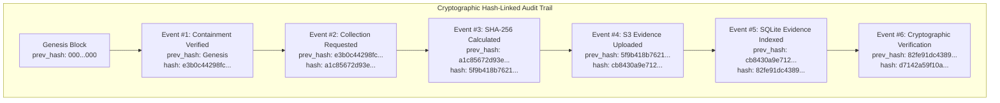

# Chain of Custody & Cryptographic Audit Ledger Guide

## Automated Ransomware Containment & Incident Response Orchestrator — Week 3 Day 5

---

## 1. Overview & Architecture

The **Forensic Chain-of-Custody Module** (`forensic/chain_of_custody.py`) provides an append-only, tamper-evident cryptographic audit ledger designed to track digital evidence throughout its entire incident response lifecycle.

Digital evidence gathered during active ransomware containment operations must withstand scrutiny in regulatory, administrative, and legal contexts. To establish that evidence has remained untampered from acquisition through analysis, each operation generates a structured audit record linked to preceding events via a continuous SHA-256 cryptographic hash chain.



### Integrated Lifecycle Events
The orchestrator automatically records audit entries at every stage of the pipeline:
1. **Endpoint Containment**: Verifies that affected hosts are in an `ISOLATED` state before collection (`CONTAINMENT_VERIFIED` / `CONTAINMENT_FAILED`).
2. **Evidence Collection**: Dispatches collection adapters for physical RAM, KAPE triage packages, or MDE investigation packages (`COLLECTION_REQUESTED`, `COLLECTION_STARTED`, `COLLECTION_COMPLETED`, `COLLECTION_FAILED`).
3. **Cryptographic Hashing**: Computes bitstream SHA-256 checksums (`HASH_CALCULATED`).
4. **Cloud Storage**: Archives evidence artifacts and JSON manifests to AWS S3 with checksum verification (`S3_UPLOADED`, `S3_UPLOAD_FAILED`).
5. **Catalog Indexing**: Indexes evidence records into SQLite with ACID transactions (`EVIDENCE_INDEXED`, `INDEXING_FAILED`).
6. **Integrity Audits**: Compares on-disk file SHA-256 with catalog records on-demand (`INTEGRITY_VERIFIED`, `INTEGRITY_REJECTED`).
7. **Artifact Triage & Correlation**: Logs automated forensic analysis and EDR alert threat scoring (`ANALYSIS_COMPLETED`, `ANALYSIS_FAILED`).

---

## 2. Audit Record Schema

Each audit record persisted in the SQLite ledger contains the following standardized fields:

| Field | Type | Description |
|---|---|---|
| `sequence_number` | `INTEGER PRIMARY KEY` | Monotonically increasing sequence number (`1, 2, 3...`) used for sequence continuity and deletion/reordering detection. |
| `event_id` | `TEXT UNIQUE` | Globally unique identifier for the event (e.g., `aud-a1b2c3d4e5f6`). |
| `action` | `TEXT` | Standardized lifecycle action (e.g., `COLLECTION_COMPLETED`, `INTEGRITY_VERIFIED`). |
| `status` | `TEXT` | Operation outcome: `SUCCESS`, `FAILURE`, or `WARNING`. |
| `timestamp` | `TEXT` | Strict UTC timestamp in ISO-8601 format (`YYYY-MM-DDTHH:MM:SS.ffffff+00:00`). |
| `actor` | `TEXT` | Subsystem, service, or operator responsible (e.g., `ForensicCollectionService`, `S3StorageService`). |
| `execution_mode` | `TEXT` | `MOCK` for simulated test runs or `REAL` for live acquisitions. |
| `event_hash` | `TEXT` | SHA-256 hex digest computed from deterministic serialization of the event payload and `previous_event_hash`. |
| `previous_event_hash` | `TEXT` | Cryptographic SHA-256 hash of the immediately preceding audit record. |
| `incident_id` | `TEXT` | Associated security incident identifier (e.g., `1001`). |
| `evidence_id` | `TEXT` | Target evidence identifier (e.g., `col-1a2b3c4d`). |
| `endpoint_id` | `TEXT` | Target host machine ID or DNS hostname. |
| `evidence_hash` | `TEXT` | SHA-256 checksum of the forensic artifact when available. |
| `source_location` | `TEXT` | Original on-disk path or acquisition source. |
| `destination_location` | `TEXT` | Target storage location (e.g., S3 URI `s3://bucket/key` or catalog db). |
| `details` | `TEXT (JSON)` | Sanitized metadata dictionary providing operational context. |

---

## 3. Cryptographic Hash Chain Implementation

### Deterministic Serialization
To prevent inconsistencies caused by dictionary key ordering or variable whitespace, audit event fields are deterministically serialized prior to hashing:

```python
payload = {
    "action": str(action),
    "actor": str(actor),
    "destination_location": str(destination_location or ""),
    "details": clean_details,
    "endpoint_id": str(endpoint_id or ""),
    "event_id": str(event_id),
    "evidence_hash": str(evidence_hash or ""),
    "evidence_id": str(evidence_id or ""),
    "execution_mode": str(execution_mode),
    "incident_id": str(incident_id or ""),
    "previous_event_hash": str(previous_event_hash),
    "sequence_number": int(sequence_number),
    "source_location": str(source_location or ""),
    "status": str(status),
    "timestamp": str(timestamp),
}

canonical_json = json.dumps(
    payload,
    sort_keys=True,
    separators=(",", ":"),
    ensure_ascii=True,
)
event_hash = hashlib.sha256(canonical_json.encode("utf-8")).hexdigest()
```

### Genesis Hash
The initial record (`sequence_number = 1`) uses a documented genesis value:
```python
GENESIS_HASH = "0" * 64  # 64 hexadecimal zeros
```

### Verification Algorithm
When `verify_audit_chain()` is executed:
1. **Empty Ledger Check**: An empty table returns `is_valid=True`, `total_events=0`.
2. **Genesis Validation**: Verifies that event #1 references `GENESIS_HASH`.
3. **Monotonic Sequence Check**: Verifies that each sequence number strictly equals `expected_sequence += 1`. Any gap indicates record deletion; out-of-order numbers indicate reordering.
4. **Hash Linkage Check**: Verifies that each record's `previous_event_hash` matches the prior record's stored `event_hash`.
5. **Content Integrity Check**: Recomputes the deterministic SHA-256 hash from the record fields and compares it with `stored_hash`. Any modification to record text, actor, status, timestamp, or details immediately triggers a verification failure.

---

## 4. Immutability & Concurrency Protection

### SQLite Immutability Triggers
To prevent ordinary database operations from silently updating or deleting audit logs, the schema includes active SQL triggers:

```sql
CREATE TRIGGER IF NOT EXISTS prevent_coc_update
BEFORE UPDATE ON chain_of_custody
BEGIN
    SELECT RAISE(ABORT, 'Audit log records are immutable and cannot be updated.');
END;

CREATE TRIGGER IF NOT EXISTS prevent_coc_delete
BEFORE DELETE ON chain_of_custody
BEGIN
    SELECT RAISE(ABORT, 'Audit log records are immutable and cannot be deleted.');
END;
```

Any attempted `UPDATE` or `DELETE` query raises a `sqlite3.IntegrityError`, aborting the transaction.

### Safe Concurrent Writes
To prevent hash fork collisions when multiple acquisition threads write simultaneously:
- Database operates in Write-Ahead Logging (`WAL`) mode with `PRAGMA busy_timeout = 20000`.
- All writes execute inside an immediate transaction (`BEGIN IMMEDIATE`) synchronized with thread re-entrant locks (`threading.RLock()`).
- Exponential backoff retry logic resolves transient SQLite busy conditions.

---

## 5. Secret Redaction Policy

Security rules mandate that credentials, passwords, and API tokens must never be written to audit logs:
- `Bearer` authentication tokens: Automatically redacted to `Bearer ***REDACTED_TOKEN***`.
- AWS Access Keys: Pattern `AKIA...` redacted to `***REDACTED_AWS_KEY***`.
- Sensitive Dictionary Keys: Any key containing `password`, `secret`, `token`, `auth`, `key`, `credential`, or `private` has its value replaced with `***REDACTED_SECRET***`.

---

## 6. Audit Inspection CLI Commands

The orchestrator CLI (`app.py`) provides commands to inspect the audit ledger:

### 1. Verify Audit Chain
Validates cryptographic integrity across the entire ledger. Returns exit code `0` on success, or `1` if tampering or sequence gaps are detected:
```bash
python app.py audit verify --mock
# Alternatively:
python app.py --audit-verify --mock
```

### 2. List Recent Audit Events
Displays the most recent events in chronological order:
```bash
python app.py audit list --mock --limit 20
# Alternatively:
python app.py --audit-list --mock --audit-limit 20
```

### 3. Inspect Specific Evidence History
Displays the complete chain of custody for an individual evidence artifact:
```bash
python app.py audit evidence col-9c02db2e82e5 --mock
# Alternatively:
python app.py --audit-evidence col-9c02db2e82e5 --mock
```

### 4. Inspect Incident History
Retrieves all audit events associated with a security incident:
```bash
python app.py audit incident 1001 --mock
# Alternatively:
python app.py --audit-incident 1001 --mock
```

---

## 7. Running the Mock Pipeline & Tests

### Executing the Full Automated Workflow
```bash
python app.py --full-workflow --mock
```

Output includes:
- Stage 1: Incident Triage & Endpoint Containment Status
- Stage 2: Forensic Evidence Acquisition
- Stage 3: AWS S3 Cloud Archival & SHA-256 Storage Checksum
- Stage 4: SQLite Evidence Catalog Indexing & Integrity Verification
- Stage 5: Artifact Triage & YARA / IOC Extraction
- Stage 6: EDR Alert Telemetry Correlation
- Stage 7: Chain-of-Custody Cryptographic Verification

### Running the Test Suite
```bash
# Run Day 5 Chain-of-Custody and Safety Tests:
pytest tests/test_chain_of_custody.py -v

# Run the complete orchestrator test suite:
pytest tests/ -v
```

---

## 8. Limitations & Production Recommendations

> [!WARNING]
> **Local Database Tamper-Resistance Limitation**
> A cryptographic hash chain stored in a local SQLite file is tamper-evident against unauthorized application modifications and casual corruption, but is **NOT independently tamper-proof** against an adversary who possesses administrative OS-level write access to the filesystem. An attacker with file-write permissions could alter historical records and recompute all subsequent SHA-256 hashes.

### Recommendations for Enterprise Deployment:
1. **WORM Cloud Archival**: Mirror every audit ledger commit to an external append-only storage tier, such as AWS S3 with **Object Lock in Compliance Mode**, preventing modification even by the AWS root account.
2. **SIEM Streaming**: Replicate audit events via TLS in real time to an external SIEM (e.g., Microsoft Sentinel, Splunk, AWS CloudWatch Logs) with centralized retention policies.
3. **Hardware Cryptographic Signing**: Sign block hashes at regular intervals using an asymmetric key pair stored inside a Hardware Security Module (HSM) or cloud KMS.
4. **Filesystem DACLs**: Enforce least-privilege file permissions on `evidence_catalog.db`, ensuring only the dedicated service account has read/write privileges.

---

## 9. Simulated vs. Real Operations

All events recorded in the audit trail explicitly differentiate execution modes:
- **`MOCK`**: Simulated forensic operations using mock Defender API endpoints, local dummy memory images, or synthetic KAPE triage packages. Artifact metadata clearly states `simulation_indicator: true`.
- **`REAL`**: Live production acquisitions executed via Microsoft Defender for Endpoint Live Response and AWS S3 APIs with authenticated IAM credentials.
